# 基础篇

## SQL

### SQL 的通用语法

1.单行或多行书写，分号结尾 2.使用空格或缩进增强语句的可读性
3.MySQL 数据库不区分大小写，关键字建议大写 4.注释：
`单行注释：--注释内容或#注释内容（MySQL）特有`
`多行注释：/*注释内容*/`

### SQL 的分类

- DDL(Data Dedinition Language)
  `数据定义语言，用来定义数据库对象(数据库，表，字段)`
- DML(Data Manipulation Language)
  `数据操作语言，用来对数据库中的数据进行增删改`
- DQL(Data Quary Language)
  `数据查询语言，用来查询数据库中表的记录`
- DCL(Data Contril Language)
  `数据控制语言，用来创建数据库用户、控制数据库的访问权限`

#### DDL 数据定义语言

##### DDL-数据库的操作

- 查询
  查询所有数据库
  `SHOW DATABASES;`
  查询当前数据库
  `SELECT DATABASE();`
- 创建
  `CREATE DATABASE [IF NOT EXISTE] 数据库名[DEFAULT CHARTSET字符集][COLLATE排序规则];`
- 删除
  `DROP DATABASE[IF EXISTS]数据库名;`
- 使用
  `USE 数据库名;`
  注意事项
  `·UTF8字符集长度为3字节，有些符号占4字节，所以推荐用utf8mb4字符集`

##### DDL-表操作-查询

- 查询当前数据库所有表
  `SHOW TABLES;`
- 查询表结构
  `DESC 表名;`
- 查询指定表的建表语句
  `SHOW CREATE TABLE 表名;`

##### DDL-表操作-创建

```CREATE TABLE 表名(
	字段1 字段1类型 [COMMENT 字段1注释],
	字段2 字段2类型 [COMMENT 字段2注释],
	字段3 字段3类型 [COMMENT 字段3注释],
	...
	字段n 字段n类型 [COMMENT 字段n注释]
)[ COMMENT 表注释 ];
# 最后一个字段后面没有逗号
```

##### DDL-添加字段

```sql
ALTER TABLE 表名 ADD 字段名 类型(长度)[COMMENT注释][约束]
exp：
ALTER TABLE emp ADD nickname varchar(20) COMMENT '昵称';
```

##### DDL-修改数据类型

`ALTER TABLE 表名 MODIFY 字段名 新数据类型(长度);`

##### DDL-修改字段名和字段类型

```sql
ALTER TABLE 表名 CHANGE 旧字段名 新字段名 类型(长度)[COMMENT 注释][约束]
exp：将emp表的nickname字段修改为username，类型为varchar(30)
ALTER emp CHANGE nickname username varchar(30) COMMENT '昵称'
```

##### DDL-删除字段

`ALTER TABLE 表名 DROP 字段名`

##### DDL-修改表名

`ALTER TABLE 表名 RENAME TO 新表名`

##### DDL-删除表

`DROP TABLE [IF EXISTS] 表名`

##### DDL-删除并重新创建该表

`TRUNCATE TABLE 表名`

#### DML 数据操作语言

##### DML-添加数据

- 指定字段：
  `INSERT INTO 表名(字段名1，字段名2，...) VALUES (值1，值2，...);`
- 全部字段：
  `INSERT INTO 表名 VALUES (值1，值2，...);`
- 批量添加数据：
  `INSERT INTO 表名 (字段名1, 字段名2, ...) VALUES (值1, 值2, ...), (值1, 值2, ...), (值1, 值2, ...);`
  `INSERT INTO 表名 VALUES (值1, 值2, ...), (值1, 值2, ...), (值1, 值2, ...);`

###### 注意事项

`字符串和日期类型数据应该包含在引号中`
`插入的数据大小应该在字段的规定范围内`

##### DML-更新和删除数据

- 修改数据
  ```sql
  UPDATE 表名 SET 字段名1 = 值1，字段名2 = 值2，...[WHERE 条件]；
  exp：
  UPDATE emp SET name = 'Jack' WHERE id = 1;
  ```
- 删除数据
  `DELETE FROM 表名 [WHERE 条件];`

#### DQL 数据查询语言

```sql
SELECT
	字段列表
FROM
	表名字段
WHERE
	条件列表
GROUP BY
	分组字段列表
HAVING
	分组后的条件列表
ORDER BY
	排序字段列表
LIMIT
	分页参数
```

##### DQL-基础查询

- 查询多个字段
  `SELECT 字段1，字段2，字段3，...，FROM 表名;`
  `SELECT * FROM 表名;`
- 设置别名
  `SELECT 字段1 [AS 别名1], 字段2[AS 别名2], 字段3[AS 别名3],...FROM 表名;`
  `SELECT 字段1 别名1, 字段2 别名2, 字段3 别名3,...FROM DUAL;`
- 去重
  `SELECT DISTINCT 字段列表 FROM 表名;`
- 转义
  `SELECT * FROM DUAL WHERE name LIKE '/_张三' ESCAPE '/';`
  `/之后的_不作为通配符`

##### DQL-条件查询

- 语法：
  SELECT 字段列表 FROM 表名 WHERE 条件列表;
- 条件：

| 比较运算符       | 功能                                     |
| ---------------- | ---------------------------------------- |
| >                | 大于                                     |
| >=               | 大于等于                                 |
| <                | 小于                                     |
| <=               | 小于等于                                 |
| =                | 等于                                     |
| <>或!=           | 不等于                                   |
| BETWEEN...AND... | 在某个范围内（含最小最大值）             |
| IN(...)          | 在 in 之后列表中的值，多选一             |
| LIKE 占位符      | 模糊匹配(\_匹配单个字符,%匹配任意个字符) |
| IS NULL          | 是 NULL                                  |

| 逻辑运算符 | 功能                           |
| ---------- | ------------------------------ |
| AND 或&&   | 并且（多个条件同时正确才正确） |
| OR 或      | 或者（多个条件一个正确就正确） |
| NOT 或！   | 非，不是                       |

- exp

```sql
-- 年龄等于30
select * from employee where age = 30;
-- 年龄小于30
select * from employee where age < 30;
-- 小于等于
select * from employee where age <= 30;
-- 没有身份证
select * from employee where idcard is null or idcard = '';
-- 有身份证
select * from employee where idcard;
select * from employee where idcard is not null;
-- 不等于
select * from employee where age != 30;
-- 年龄在20到30之间
select * from employee where age between 20 and 30;
select * from employee where age >= 20 and age <= 30;
-- 下面语句不报错，但查不到任何信息
select * from employee where age between 30 and 20;
-- 性别为女且年龄小于30
select * from employee where age < 30 and gender = '女';
-- 年龄等于25或30或35
select * from employee where age = 25 or age = 30 or age = 35;
select * from employee where age in (25, 30, 35);
-- 姓名为两个字
select * from employee where name like '__';
-- 身份证最后为X
select * from employee where idcard like '%X';
```

##### DQL-聚合查询(聚合函数)

- 常见聚合函数：

| 函数  | 功能     |
| ----- | -------- |
| count | 统计数量 |
| max   | 最大值   |
| min   | 最小值   |
| avg   | 平均值   |
| sum   | 求和     |

- 语法：
  `SELECT 聚合函数(字段列表) FROM 表名;`
- exp：
  `SELECT count(id) from emploee where workaddress = "广东省";`

##### DQL-分组查询

- 语法：
  `SELECT 字段列表 FROM 表名[WHERE 条件] GROUP BY 分组字段名[HANVING 分组后的过滤条件];`
- where 和 having 的区别

```sql
-- 执行时机不同：where是分组之前进行过滤，不满足where条件不参与分组；having是分组后
  对结果进行过滤
-- 判断条件不同：where不能对聚合函数进行判断，而having可以
```

- exp：

```sql
-- 根据性别分组，统计男性和女性数量（只显示分组数量，不显示哪个是男哪个是女）
select count(*) from employee group by gender;
-- 根据性别分组，统计男性和女性数量
select gender, count(*) from employee group by gender;
-- 根据性别分组，统计男性和女性的平均年龄
select gender, avg(age) from employee group by gender;
-- 年龄小于45，并根据工作地址分组
select workaddress, count(*) from employee where age < 45 group by workaddress;
-- 年龄小于45，并根据工作地址分组，获取员工数量大于等于3的工作地址
select workaddress, count(*) address_count from employee where age < 45 group by workaddress having address_count >= 3;
```

###### 注意事项

- 执行顺序：where>聚合函数>having
- 分组之后，查询的字段一般为聚合函数和分组字段，查询其他字段无任何意义

##### DQL-排序查询

- ASC：升序（默认）
- DESC：降序
- exp：

```sql
-- 根据年龄升序排序
SELECT * FROM employee ORDER BY age ASC;
SELECT * FROM employee ORDER BY age;
-- 两字段排序，根据年龄升序排序，入职时间降序排序
SELECT * FROM employee ORDER BY age ASC, entrydate DESC;
```

###### 注意事项

如果是多字段排序，当地一个字段值相同时，才会根据第二个字段进行排序

##### DQL-分页查询

- 语法：
  `SELECT 字段列表 FROM 表名 LIMIT 起始索引, 查询记录数;`
- exp：

```sql
-- 查询第一页数据，展示10条
SELECT * FROM employee LIMIT 0, 10;
-- 查询第二页
SELECT * FROM employee LIMIT 10, 10;
```

###### 注意事项

- 起始索引从 0 开始，其实索引=(查询页码-1) \* 每页显示记录数
- 分页查询是数据库的方言，不同数据库有不同实现，MySQL 是 LIMIT
- 如果查询的是第一页数据，起始索引可以省略，直接简写 LIMIT 10

##### DQL 执行顺序

###### **FROM -> WHERE -> GROUP BY -> SELECT -> ORDER BY -> LIMIT**

#### DCL 数据控制语言

##### DCL-管理用户

- 查询用户
  `USE mysql;`
  `SELECT * FROM user;`
- 创建用户
  `CREATE USER '用户名'@'主机名' IDENTIFIED BY '密码';`
- 修改用户密码
  `ALTER USER '用户名'@'主机名' IDENTIFIED WITH mysql_native_password BY '新密码';`
- 删除用户
  `DROP USER '用户名'@'主机名';`
- exp：

```sql
-- 创建用户test，只能在当前主机localhost访问
create user 'test'@'localhost' identified by '123456';
-- 创建用户test，能在任意主机访问
create user 'test'@'%' identified by '123456';
create user 'test' identified by '123456';
-- 修改密码
alter user 'test'@'localhost' identified with mysql_native_password by '1234';
-- 删除用户
drop user 'test'@'localhost';

```

###### 注意事项

`想要任意主机访问，主机名可以使用通配符%`

##### DCL-权限控制

- 常用权限：

| 权限              | 说明               |
| ----------------- | ------------------ |
| ALL,ALLPRIVILEGES | 所有权限           |
| SELECT            | 查询权限           |
| INSERT            | 插入权限           |
| UPDATE            | 修改权限           |
| DELETE            | 删除权限           |
| ALTER             | 修改表             |
| DROP              | 删除数据库/表/视图 |
| CREATE            | 创建数据库/表      |

- 查询权限
  SHOW GRANT FOR '用户名'@'主机名';
- 授予权限
  GRANT 权限列表 ON 数据库名/表名 TO '用户名'@'主机名';
- 撤销权限
  REVOKE 权限列表 ON 数据库名/表名 FROM '用户名'@'主机名';

###### 注意事项

- 多个权限用逗号分隔
- 授权时，数据库名和表名可以用\*进行通配，代表所有

## 函数

- 字符串函数
- 数值函数
- 日期函数
- 流程函数

### 字符串函数

常用函数：
| 函数 | 功能 |
| - | - |
| CONCAT(s1,s2,...sn) | 字符串拼接，将 s1，s2，...，sn 拼接成一个字符串 |
| LOWER(str) | 将字符串全部转为小写 |
| UPPER(str) | 将字符串全部转为大写 |
| LPAD(str,n,pad) | 左填充，用字符串 pad 对 str 的左边进行填充，达到 n 个字符串长度 |
| RPAD(str,n,pad) | 右填充，用字符串 pad 对 str 的右边进行填充，达到 n 个字符串长度 |
| TRIM(str) | 去掉字符串头部和尾部的空格 |
| SUBSTRING(str,start,len) | 返回从字符串 str 从 start 位置起的 len 个长度的字符串 |
| REPLACE(column,source,replace) | 替换字符串 |

使用示例：

```sql
- 拼接
SELECT CONCAT('Hello', 'World');
-- 小写
SELECT LOWER('Hello');
-- 大写
SELECT UPPER('Hello');
-- 左填充
SELECT LPAD('01', 5, '-');
-- 右填充
SELECT RPAD('01', 5, '-');
-- 去除空格
SELECT TRIM(' Hello World ');
-- 切片（起始索引为1）
SELECT SUBSTRING('Hello World', 1, 5);

```

### 数值函数

常用函数：
| 函数 | 功能 |
| - | - |
| CEIL(x) | 向上取整 |
| FLOOR(x) | 向下取整 |
| MOD(x,y) | 返回 x/y 的模 |
| RAND() | 返回 0~1 内的随机数 |
| ROUND(x,y) | 求参数 x 的四舍五入值，保留 y 个小数位 |

### 日期函数

常用函数：
| 函数 | 功能 |
| - | - |
| CURDATE() | 返回当前日期 |
| CURTIME() | 返回当前时间 |
| NOW() | 返回当前日期和时间 |
| YEAR(date) | 获取指定 date 的年份 |
| MONTH(date) | 获取指定 date 的月份 |
| DAY(date) | 获取指定 date 的日期 |
| DATE_ADD(date,INTERVAL expr type) | 返回一个日期/时间值加上一个时间间隔 expr 后的时间值 |
| DATEDIFF(date1,date2) | 返回起始时间 date1 和结束时间 date2 之间的天数 |

exp：
`-- DATE_ADD`
`SELECT DATE_ADD(NOW(), INTERVAL 70 YEAR);`

### 流程函数

常用函数：
| 函数 | 功能 |
| - | - |
| IF(value,t,f) | 如果 value 为 true，则返回 t，否则返回 f |
| IFNULL(value1,value2) | 如果 value1 不为空，返回 value1，否则返回 value2 |
| CASE WHEN [val1] THEN [res1] ...ELSE [default] END| 如果 val1 为 true，返回 res1，...否则返回 default 默认值 |
| CASE expr WHEN [val1] THEN [res1] ...ELSE [default] END | 如果 expr 的值等于 val1，返回 res1，...否则返回 default 默认值 |

exp：

```sql
SELECT name,(case when age > 30 then '中年' else '青年' end）
FROM employee;
SELECT name,(case workaddress when '北京市' then '一线城市' when '上海市' then '一线城市' else
'二线城市' end) as '工作地址'
FROM employee;

```

## 约束

分类：
| 约束 | 描述 | 关键字 |
| - | - | - |
| 非空约束 | 限制该字段的数据不能为 null | NOT NULL |
| 唯一约束 | 保证该字段的所有数据都是唯一、不重复的 | UNION |
| 主键约束 | 主键是一行数据的唯一标识，要求非空且唯一 | PRIMARY KEY |
| 默认约束 | 保存数据时，如果未指定该字段的值，则采用默认值 | DEFAULT |
| 检查约束(8.0.1 后) | 保证字段满足某一条件 | CHECK |
| 外键约束 | 用来让两张图的数据之间建立连接，保证数据的一致性和完整性 | FOREIGE KEY |

`约束是作用于表中字段的，可以在创建/修改表时添加约束`

### 常用约束

| 约束条件 | 关键字         |
| -------- | -------------- |
| 主键     | PRIMARY KEY    |
| 自动增长 | AUTO_INCREMENT |
| 不为空   | NOT NULL       |
| 唯一     | UNION          |
| 逻辑条件 | CHECK          |
| 默认值   | DEFAULT        |

EXP:

```sql
create table user(
	id int primary key auto_increment,
	name varchar(10) not null unique,
	age int check(age > 0 and age < 120),
	status char(1) default '1',
	gender char(1)
);

```

### 外键约束

添加外键：

```sql
CREATE TABLE 表名(
	字段名 字段类型,
	...
	[CONSTRAINT] [外键名称] FOREIGN KEY(外键字段名) REFERENCES 主表(主表列名)
);
ALTER TABLE 表名 ADD CONSTRAINT 外键名称 FOREIGN KEY (外键字段名) REFERENCES 主表(主表列名);

-- 例子
alter table emp add constraint fk_emp_dept_id foreign key(dept_id) references dept(id);

```

删除外键：
`ALTER TABLE 表名 DROP FOREIGN KEY 外键名;`

### 删除/更新行为

| 行为        | 说明                                                                                                                  |
| ----------- | --------------------------------------------------------------------------------------------------------------------- |
| NO ACTION   | 当在父表中删除/更新对应记录时，首先检查该记录是否有对应外键，如果有则不允许删除/更新(与 RESTRICT 一致)                |
| RESTRICT    | 当在父表中删除/更新对应记录时，首先检查该记录是否有对应外键，如果有则不允许删除/更新(与 NO ACTION 一致)               |
| CASCADE     | 当在父表中删除/更新对应记录时，首先检查该记录是否有对应外键，如果有则也删除/更新外键在子表中的记录                    |
| SET NULL    | 当在父表中删除/更新对应记录时，首先检查该记录是否有对应外键，如果有则设置子表中该外键值为 null(要求该外键允许为 null) |
| SET DEFAULT | 父表有变更时，子表将外键设为一个默认值(InnoDB 不支持)                                                                 |

更改删除/更新行为：
`ALTER TABLE 表名 ADD CONSTRAINT 外键名称 FOREIGN KEY (外键字段) REFERENCES 主表名(主表字段名) ON UPDATE 行为 ON DELETE 行为;`

## 多表查询

### 多表关系

- 一对多(多对一)
- 多对多
- 一对一

#### 一对多

案例：部门与员工
关系：一个部门对应多个员工，一个员工对应一个部门
实现：在多的一方建立外键，指向一的一方的主键

#### 多对多

案例：学生与可能
关系：一个学生可以选择多门课程，一门可能也可以供多个学生选择
实现：建立第三张中间表，中间表至少包含两个外键，分别关联两方主键

#### 一对一

案例：用户与用户详情
关系：一对一关系，用于多表拆分，将一张表的基础字段放在一张表中，其他详情字段放在另一张表中，一提升操作效率
实现：在任意一方加入外键，关联另一方的主键，并且设置外键为唯一的(UNIQUE)

### 查询

合并查询（笛卡尔积，会展示所有的组合结果）：
`select * from employee dept;`
消除无效笛卡尔积：
`select * from employee ，dept where employee.dept = dept.id`

#### 内连接查询

内连接查询的是两张表的交集部分

- 隐式内连接
  SELECT 字段列表 FROM 表 1，表 2 WHERE 条件 ...;
- 显示内连接
  SELECT 字段列表 FROM 表 1 [INNER] JOIN 表 2 ON 连接条件 ...;
- EXP：

```sql
-- 查询员工姓名，及关联的部门的名称
-- 隐式
select e.name, d.name from employee as e, dept as d where e.dept = d.id;
-- 显式
select e.name, d.name from employee as e inner join dept as d on e.dept = d.id;

```

#### 外连接查询

- 左外连接：
  查询左表所有数据，以及两张表交集部门数据
  SELECT 字段列表 FROM 表 1 LEFT [INNER] JOIN 表 2 ON 条件 ...;
- 右外连接：
  查询右表所有数据，以及两张表交集部门数据
  SELECT 字段列表 FROM 表 1 RIGHT [INNER] JOIN 表 2 ON 条件 ...;
- EXP：

```sql
-- 左
select e.*, d.name from employee as e left outer join dept as d on e.dept = d.id;
select d.name, e.* from dept d left outer join emp e on e.dept = d.id;  -- 这条语句与下面的语句效果一样
-- 右
select d.name, e.* from employee as e right outer join dept as d on e.dept = d.id;

```

左连接可以查询到没有 dept 的 employee， 右连接可以查询到没有 employee 的 dept

#### 自连接查询

当前表与自身连接查询，子链接必须使用表别名
语法：
`SELECT 字段列表 FORM 表A 别名A JOIN 表A 别名B ON 条件;`
自连接查询，可以是内连接查询，也可以是外连接查询
EXP：

```sql
-- 查询员工及其所属领导的名字
select a.name, b.name from employee a, employee b where a.manager = b.id;
-- 没有领导的也查询出来
select a.name, b.name from employee a left join employee b on a.manager = b.id;

```

#### 联合查询 union，union all

把多次查询的结果合并，形成一个新的查询集
语法：

```sql
SELECT 字段列表 FROM 表A ...
UNION [ALL]
SELECT 字段列表 FROM 表B ...

```

##### 注意事项

- UNION ALL 会有重复结果，UNION 已经去重
- 联合查询比使用 or 效率高，不会使索引失败

#### 子查询

SQL 语句中嵌套 SEKECT，称为嵌套查询，又称子查询
`SELECT \* FROM t1 WHERE column1 = ( SELECT column1 FROM t2);`
**子查询外部的语句可以是 INSERT/UPDATE/DELETE/SELECT 的任何一个**

根据子查询的结果可以分为：

- 标量子查询（子查询结果为单个值）
- 列子查询（子查询结果为一列）
- 行子查询（子查询结果为一行）
- 表子查询（子查询结果为多行多列）

根据子查询的位置可以分为：

- WHERE 之后
- FROM 之后
- SELECT 之后

##### 标量子查询

子查询返回结果为单个值（数字、字符串、日期等）
常用操作符： - < > > >= < <=
EXP:

```sql
-- 查询销售部所有员工
select id from dept where name = '销售部';
-- 根据销售部部门ID，查询员工信息
select * from employee where dept = 4;
-- 合并（子查询）
select * from employee where dept = (select id from dept where name = '销售部');

-- 查询xxx入职之后的员工信息
select * from employee where entrydate > (select entrydate from employee where name = 'xxx');

```

##### 列子查询

返回的结果是一列（可以是多行）
常用操作符：

| 操作符 | 描述 |
| - | - |
| IN | 在指定的合集范围内，多选一 |
| NOT IN | 不在指定的集合范围内 |
| ANY | 子查询返回列表中，有任意一个满足即可 |
| SOME | 与 ANY 相同，使用 SOME 的地方都可以使用 ANY |
| ALL | 子查询返回列表的所有值必须满足 |

EXP：

```sql
-- 查询销售部和市场部的所有员工信息
select * from employee where dept in (select id from dept where name = '销售部' or name = '市场部');
-- 查询比财务部所有人工资都高的员工信息
select * from employee where salary > all(select salary from employee where dept = (select id from dept where name = '财务部'));
-- 查询比研发部任意一人工资高的员工信息
select * from employee where salary > any (select salary from employee where dept = (select id from dept where name = '研发部'));

```

##### 行子查询

返回的结果是一行（可以是多列）
常用操作符： =,<,>,IN,NOT IN
EXP:

```sql
-- 查询与xxx的薪资及直属领导相同的员工信息
select * from employee where (salary, manager) = (12500, 1);
select * from employee where (salary, manager) = (select salary, manager from employee where name = 'xxx');

```

##### 表子查询

返回的结果是多行多列
常用操作符：IN
EXP：

```sql
-- 查询与xxx1，xxx2的职位和薪资相同的员工
select * from employee where (job, salary) in (select job, salary from employee where name = 'xxx1' or name = 'xxx2');
-- 查询入职日期是2006-01-01之后的员工，及其部门信息
select e.*, d.* from (select * from employee where entrydate > '2006-01-01') as e left join dept as d on e.dept = d.id;

```

## 事务

事务是一组操作的集合，事务会把所有的操作作为一个整体一起向系统提交或撤销操作请求，即这些操作要么同时成功，要么同时失败

### 基本操作：

```sql
-- 1. 查询张三账户余额
select * from account where name = '张三';
-- 2. 将张三账户余额-1000
update account set money = money - 1000 where name = '张三';
-- 此语句出错后张三钱减少但是李四钱没有增加
模拟sql语句错误
-- 3. 将李四账户余额+1000
update account set money = money + 1000 where name = '李四';

-- 查看事务提交方式
SELECT @@AUTOCOMMIT;
-- 设置事务提交方式，1为自动提交，0为手动提交，该设置只对当前会话有效
SET @@AUTOCOMMIT = 0;
-- 提交事务
COMMIT;
-- 回滚事务
ROLLBACK;

-- 设置手动提交后上面代码改为：
select * from account where name = '张三';
update account set money = money - 1000 where name = '张三';
update account set money = money + 1000 where name = '李四';
commit;

```

### 操作方式二：

开启事务：
`START TRANSACTION 或 BEGIN TRANSACTION;`
提交事务：
`COMMIT;`
回滚事务：
`ROLLBACK;`
操作实例：

```sql
start transaction;
select * from account where name = '张三';
update account set money = money - 1000 where name = '张三';
update account set money = money + 1000 where name = '李四';
commit;

```

### 四大特性 ACID

- 原子性（Atomicity）：事务是不可分割的最小操作单元，要么全部成功，要么全部失败
- 一致性（Consistency）：事务完成时，必须使所有事务保持一致状态
- 隔离性（Isolation）：数据库系统提供的隔离机制，保证事务在不受外部并发操作影响的独立环境下运行
- 持久性（Durability）：事务一旦提交或回滚，它对数据库中的数据的改变就是永久的

### 并发事务

| 问题       | 描述                                                                                 |
| ---------- | ------------------------------------------------------------------------------------ |
| 脏读       | 一个事务读到另一个事务还没提交的数据                                                 |
| 不可重复读 | 一个事务先后读取同一条记录，但两次读到的数据不同                                     |
| 幻读       | 一个事务按照条件查询数据时，没有对应的数据行，但再插入数据时，又发现这行数据已经存在 |

#### 并发事务隔离级别：

| 隔离级别                | 脏读 | 不可重复读 | 幻读 |
| ----------------------- | ---- | ---------- | ---- |
| Read uncommitted        | √    | √          | √    |
| Read committed          | ×    | √          | √    |
| Repeatable Read（默认） | ×    | ×          | √    |
| Serializable            | ×    | ×          | ×    |

- √ 表示在当前隔离级别下该问题会出现
- Serializable 性能最低；Read uncommitted 性能最高，数据安全性最差

查看事务隔离级别:
`SELECT @@TRANSACTION_ISLATION`
设置事务隔离级别:
`SET [ SESSION | GLOBAL ] TRANSACTION ISOLATION LEVEL {READ UNCOMMITTED | READ COMMITTED | REPEATABLE READ | SERIALIZABLE };`
SESSION 是会话级别，表示只针对当前会话有效，GLOBAL 表示对所有会话有效

# 进阶篇

## 存储引擎

MySQL 体系结构：
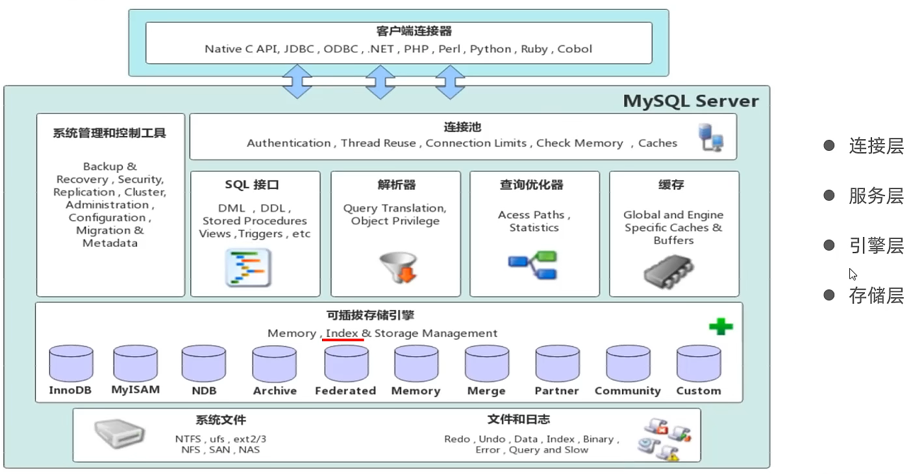
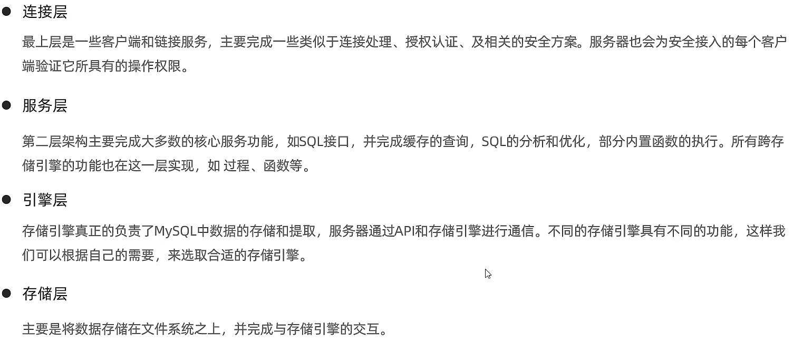

存储引擎就是存储数据、建立索引、更新/查询数据等技术的实现方式。存储引擎是基于表而不是基于库的，所以存储引擎也可以被称为表引擎。
MySQL 默认存储引擎是 InnoDB

相关操作：

```sql
-- 查询建表语句
show create table account;
-- 建表时指定存储引擎
CREATE TABLE 表名(
	...
) ENGINE=INNODB;
-- 查看当前数据库支持的存储引擎
show engines;

```

### InnoDB

InnoDB 是一种兼顾高可靠性和高性能的通用存储引擎，在 MySQL5.5 之后，InnoDB 都是默认的搜索引擎

- 特点
  - DML 操作遵循 ACID 模型，支持事务
  - 行级锁，提高并发访问性能
  - 支持外键约束，保证数据的完整性和正确性
- 文件
  - xxx.ibd:xxx 代表表名，InnoDB 引擎的每张表都对应这样一个表空间文件，存储该表的表结构(frm、sdi)、数据和索引
- 参数
  innodb_file_per_table，决定多张表共享一个表空间还是每张表对应一个表空间

查看 MySQL 变量：
`show variables like 'innodb_file_per_table';`
从 odb 文件提取表结构数据（cmd）：
`idb2sdi xxx.idb`
InnoDB 逻辑存储结构：
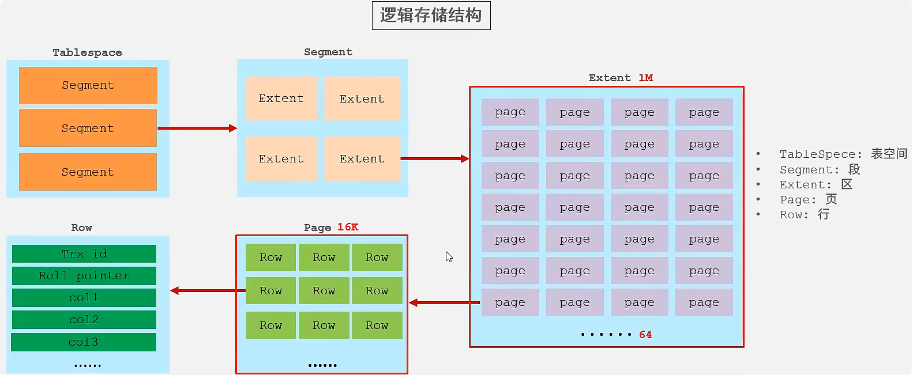

### MyISAM

MyISAM 是 MySQL 早期的默认存储引擎

- 特点：
  - 不支持事务，不支持外键
  - 支持表锁，不支持行锁
  - 访问速度快
- 文件：
- xxx.sdi:存储表结构信息
- xxx.MYD:存储数据
- xxx.MYI:存储索引

### Memory

Memory 引擎的表数据是存储在内存中的，受硬件问题、断电问题的影响，只能将这些表作为临时表或缓存使用

- 特点：
  - 存放在内存中，速度快
  - hash 索引（默认）
- 文件：
  - xxx.sdi：存储表结构信息

### 存储引擎的特点：

dasd

### 存储引擎的选择：

`在选择存储引擎时，应该根据应用系统的特点选择合适的存储引擎。对于复杂的应用系统，还可以根据实际情况选择多种存储引擎进行组合。`

- InnoDB：如果应对事物的完整性有比较高的要求，在并发条件下要求 数据的一致性，数据操作除了插入和查询之外，还包含很多的更新、删除操作，则 InnoDB 是比较合适的选择
- MyISAM：如果应用是以读操作和插入操作为主，只有很少的更新和删除操作，并且对事务的完整性、并发性要求不高，那这个存储引擎是非常合适
- Memory：将所有数据保存在内存中，访问速度快，通常用于临时表以及缓存。Memory 的缺陷是对表的大小有限制，太大的表无法缓存在内存中，而且无法保障数据的安全性

**电商中的足迹和评论适合使用 MyISAM，缓存适合使用 Memory 引擎**

## 性能分析

### 查看执行频次

查看当前数据库的 INSERT、UPDATE、DELETE、SELECT 访问频次：
`SHOW GLOBAL STATUS LIKE 'Com___';`
`SHOW SESSION STATUS LIKE 'Com___';`

### 慢查询日志

慢查询日志记录了所有执行时间超过指定参数（long_query_time，单位：秒，默认 10 秒）的所有 SQL 语句的日志
MySQL 的慢查询日志默认没有开启，需要 MySQL 的配置文件(/etc/my.cnf)中配置如下信息：

```sql
# 开启慢查询日志开关
slow_query_log=1
# 设置慢查询日志的时间为2秒，SQL语句执行时间超过2秒，就会视为慢查询，记录慢查询日志
long_query_time=2
更改后记得重启MySQL服务，日志文件位置：/var/lib/mysql/localhost-slow.log

```

查看慢查询日志开关状态：
`show variable like 'slow_query_log';`

### profile

show profile 能在做 SQL 优化时帮我们了解时间都耗费在哪里。通过 have_profiling 参数，能看到当前 MySQL 是否支持 profile 操作：
`SELECT @@have_profiling;`
profiling 默认关闭，可以通过 set 语句在 session/global 级别开启 profiling：
`SET profiling = 1;`
查看所有语句的耗时：
`show profiles;`
查看指定 query_id 的 SQL 语句各个阶段的耗时：
`show profile for query query_id;`
查看指定 query_id 的 SQL 语句 CPU 的使用情况
`show profile cpu for query query_id;`

### explain

EXPLAIN 或者 DESC 命令获取 MySQL 如何执行 SELECT 语句的信息，包括在 SELECT 语句执行过程中表如何连接和连接的顺序。
语法：

```sql
# 直接在select语句之前加上关键字 explain / desc
EXPLAIN SELECT 字段列表 FROM 表名 HWERE 条件;

```

EXPLAIN 各字段的含义：

- id：select 查询的序列号，表示查询中执行 select 子句或者操作表的顺序（id 相同，执行顺序从上到下；id 不同，值越大越先执行）
- select_type:表示 SELECT 的类型，常见取值有 SIMPLE（简单表，即不适于表连接或者子查询）、PRIMARY（主查询，即外层的查询）、UNION（UNION 中的第二个或者后面的查询语句）、SUBQUERY（SELECT/WHERE 之后包含了子查询）等
- type：表示连接类型，性能由好到差的连接类型为 NULL、system、const、eq_ref、ref、range、index、all
- possible_key：可能应用在这张表上的索引，一个或多个
- Key：实际使用的索引，如果为 NULL，则没有使用索引
- Key_len：表示索引中使用的字节数，该值为索引字段最大可能长度，并非实际使用长度，在不损失精确性的前提下，长度越短越好
- Rows：MySQL 认为必须要执行的行数，在 InnoDB 引擎的表中，是一个估计值，可能并不总是准确的
- filtered：表示返回结果的行数占需读取行数的百分比，filtered 的值越大越好

## 索引

索引是帮助 MySQL 高效获取数据的数据结构（有序）。在数据之外，数据库系统还维护着满足特定查找算法的数据结构，这些数据结构以某种方式引用（指向）数据，这样就可以在这些数据结构上实现高级查询算法，这种数据结构就是索引。

优点：

- 提高数据检索效率，降低数据库的 IO 成本
- 通过索引列对数据进行排序，降低数据排序的成本，降低 CPU 的消耗
  缺点：
- 索引列也是要占用空间的
- 索引大大提高了查询效率，但降低了更新的速度，比如 INSERT、UPDATE、DELETE

### 索引结构

| 索引结构           | 描述                                                                             |
| ------------------ | -------------------------------------------------------------------------------- |
| B+Tree             | 最常见的索引类型，大部分引擎都支持 B+树索引                                      |
| Hash               | 底层数据结构是用哈希表实现，只有精确匹配索引列的查询才有效，不支持范围查询       |
| R-Tree(空间索引)   | 空间索引是 MyISAM 引擎的一个特殊索引类型，主要用于地理空间数据类型，通常使用较少 |
| ull-Text(全文索引) | 是一种通过建立倒排索引，快速匹配文档的方式，类似于 Lucene, Solr, ES              |

| 索引        | InnoDB         | MyISAM | emory  |
| ----------- | -------------- | ------ | ------ |
| B+Tree 索引 | 支持           | 支持   | 支持   |
| Hash 索引   | 不支持         | 不支持 | 支持   |
| R-Tree 索引 | 不支持         | 支持   | 不支持 |
| Full-text   | 5.6 版本后支持 | 支持   | 不支持 |

### B-Tree

结构图：
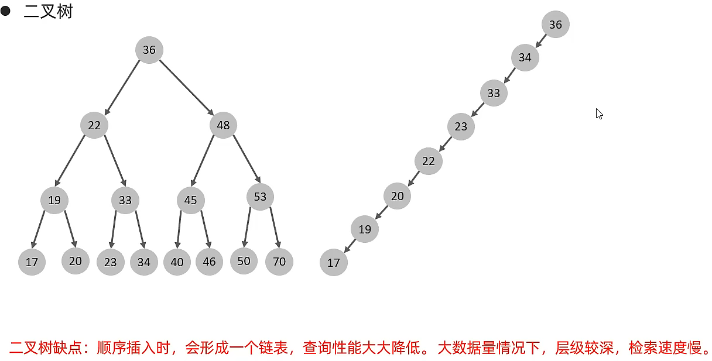

二叉树的缺点可以用红黑树来解决：
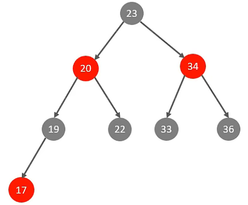
红黑树也存在大数据量情况下，层级较深，检索速度慢的问题。

为了解决上述问题，可以使用 B-Tree 结构。
B-Tree (多路平衡查找树) 以一棵最大度数（max-degree，指一个节点的子节点个数）为 5（5 阶）的 b-tree 为例（每个节点最多存储 4 个 key，5 个指针）

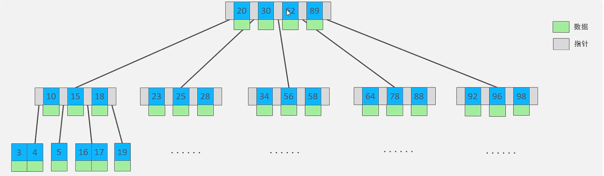

[演示地址](https://www.cs.usfca.edu/~galles/visualization/BTree.html)

### B+Tree

结构图：
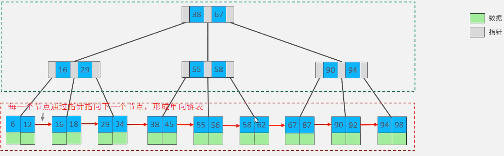

[演示地址](https://www.cs.usfca.edu/~galles/visualization/BPlusTree.html)

与 B-Tree 的区别：

- 所有的数据都会出现在叶子节点
- 叶子节点形成一个单向链表

MySQL 索引数据结构对经典的 B+Tree 进行了优化。在原 B+Tree 的基础上，增加一个指向相邻叶子节点的链表指针，就形成了带有顺序指针的 B+Tree，提高区间访问的性能。
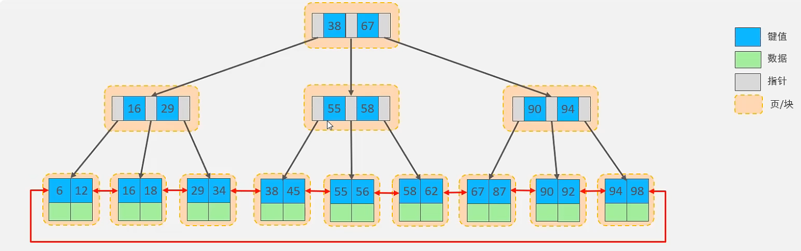

### Hash

哈希索引就是采用一定的 hash 算法，将键值换算成新的 hash 值，映射到对应的槽位上，然后存储在 hash 表中。
如果两个（或多个）键值，映射到一个相同的槽位上，他们就产生了 hash 冲突（也称为 hash 碰撞），可以通过链表来解决。

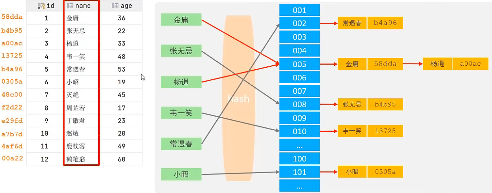


特点：

- Hash 索引只能用于对等比较（=、in），不支持范围查询（between、>、<、…）
- 无法利用索引完成排序操作
- 查询效率高，通常只需要一次检索就可以了，效率通常要高于 B+Tree 索引

储引擎支持：

- Memory
- InnoDB: 具有自适应 hash 功能，hash 索引是存储引擎根据 B+Tree 索引在指定条件下自动构建的

### 面试题

为什么 InnoDB 存储引擎选择使用 B+Tree 索引结构？

- 相对于二叉树，层级更少，搜索效率高
- 对于 B-Tree，无论是叶子节点还是非叶子节点，都会保存数据，这样导致一页中存储的键值减少，指针也跟着减少，要同样保存大量数据，只能增加树的高度，导致性能降低
- 相对于 Hash 索引，B+Tree 支持范围匹配及排序操作

### 索引分类

| 分类     | 含义                                                 | 特点                     | 关键字   |
| -------- | ---------------------------------------------------- | ------------------------ | -------- |
| 主键索引 | 针对于表中主键创建的索引                             | 默认自动创建，只能有一个 | PRIMARY  |
| 唯一索引 | 避免同一个表中某数据列中的值重复                     | 可以有多个               | UNIQUE   |
| 常规索引 | 快速定位特定数据                                     | 可以有多个               |          |
| 全文索引 | 全文索引查找的是文本中的关键词，而不是比较索引中的值 | 可以有多个               | FULLTEXT |

在 InnoDB 存储引擎中，根据索引的存储形式，又可以分为以下两种：

| 分类                      | 含义                                                       | 特点                 |
| ------------------------- | ---------------------------------------------------------- | -------------------- |
| 聚集索引(Clustered Index) | 将数据存储与索引放一块，索引结构的叶子节点保存了行数据     | 必须有，而且只有一个 |
| 二级索引(Secondary Index) | 将数据与索引分开存储，索引结构的叶子节点关联的是对应的主键 | 可以存在多个         |

演示：
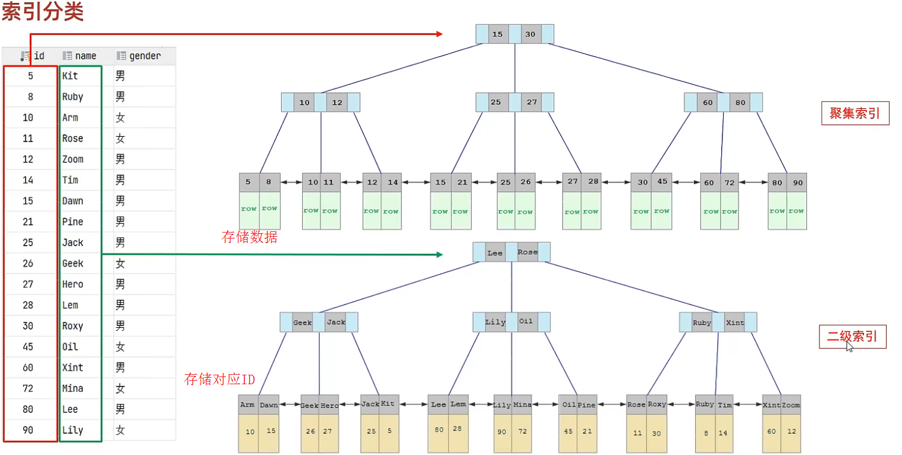

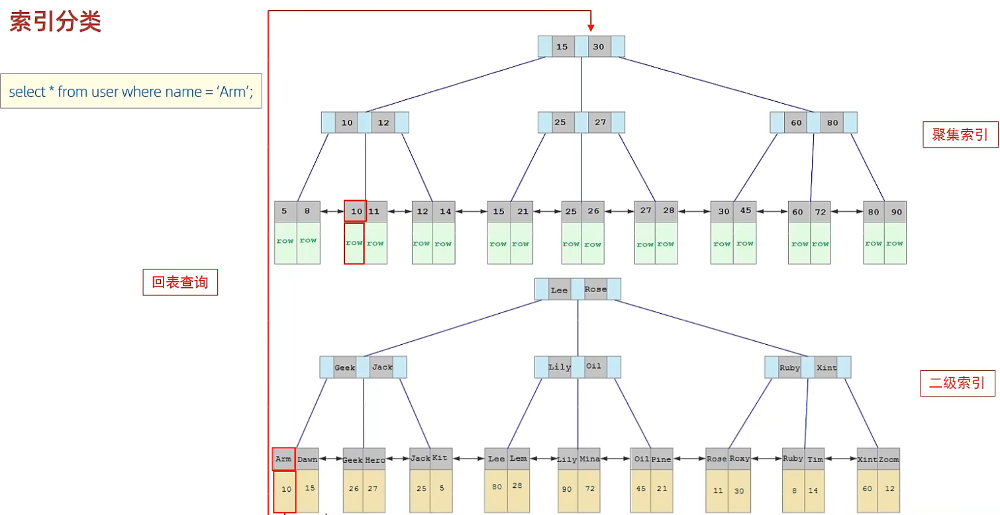

聚集索引选取规则：

- 如果存在主键，主键索引就是聚集索引
- 如果不存在主键，将使用第一个唯一(UNIQUE)索引作为聚集索引
- 如果表没有主键或没有合适的唯一索引，则 InnoDB 会自动生成一个 rowid 作为隐藏的聚集索引

#### 思考题：

1. 以下 SQL 语句，哪个执行效率高？为什么？

```sql
select * from user where id = 10;
select * from user where name = 'Arm';
-- 备注：id为主键，name字段创建的有索引

```

答：第一条语句，因为第二条需要回表查询，相当于两个步骤。

2. InnoDB 主键索引的 B+Tree 高度为多少？

答：假设一行数据大小为 1k，一页中可以存储 16 行这样的数据。InnoDB 的指针占用 6 个字节的空间，主键假设为 bigint，占用字节数为 8.
可得公式：n _ 8 + (n + 1) _ 6 = 16 \* 1024，其中 8 表示 bigint 占用的字节数，n 表示当前节点存储的 key 的数量，(n + 1) 表示指针数量（比 key 多一个）。算出 n 约为 1170。

如果树的高度为 2，那么他能存储的数据量大概为：1171 _ 16 = 18736；
如果树的高度为 3，那么他能存储的数据量大概为：1171 _ 1171 \* 16 = 21939856。

另外，如果有成千上万的数据，那么就要考虑分表，涉及运维篇知识。

### 语法

创建索引：
`CREATE [ UNIQUE | FULLTEXT ] INDEX index_name ON table_name (index_col_name, ...);`
删除索引：
`DROP INDEX index_name ON table_name;`
案例：

```sql
-- name字段为姓名字段，该字段的值可能会重复，为该字段创建索引
create index idx_user_name on tb_user(name);
-- phone手机号字段的值非空，且唯一，为该字段创建唯一索引
create unique index idx_user_phone on tb_user (phone);
-- 为profession, age, status创建联合索引
create index idx_user_pro_age_stat on tb_user(profession, age, status);
-- 为email建立合适的索引来提升查询效率
create index idx_user_email on tb_user(email);

-- 删除索引
drop index idx_user_email on tb_user;

```

### 使用规则

#### 最左前缀法则

如果索引关联了多列（联合索引），要遵守最左前缀法则，最左前缀法则指的是查询从索引的最左列开始，并且不跳过索引中的列。
如果跳跃某一列，索引将部分失效（后面的字段索引失效）。

联合索引中，出现范围查询（<, >），范围查询右侧的列索引失效。可以用>=或者<=来规避索引失效问题。

#### 索引失效情况

1.在索引列上进行运算操作，索引将失效。如：explain select \_ from tb_user where substring(phone, 10, 2) = '15';

2.字符串类型字段使用时，不加引号，索引将失效。如：explain select \_ from tb_user where phone = 17799990015;，此处 phone 的值没有加引号

3.模糊查询中，如果仅仅是尾部模糊匹配，索引不会是失效；如果是头部模糊匹配，索引失效。如：explain select \* from tb_user where profession like '%工程';，前后都有 % 也会失效。

4.用 or 分割开的条件，如果 or 其中一个条件的列没有索引，那么涉及的索引都不会被用到。

5.如果 MySQL 评估使用索引比全表更慢，则不使用索引。

#### SQL 提示

是优化数据库的一个重要手段，简单来说，就是在 SQL 语句中加入一些人为的提示来达到优化操作的目的。

例如，使用索引：
`explain select * from tb_user use index(idx_user_pro) where profession="软件工程";`
不使用哪个索引：
`explain select * from tb_user ignore index(idx_user_pro) where profession="软件工程";`
必须使用哪个索引：
`explain select * from tb_user force index(idx_user_pro) where profession="软件工程";`

use 是建议，实际使用哪个索引 MySQL 还会自己权衡运行速度去更改，force 就是无论如何都强制使用该索引。

#### 覆盖索引&回表查询

尽量使用覆盖索引（查询使用了索引，并且需要返回的列，在该索引中已经全部能找到），减少 select \*。

explain 中 extra 字段含义：
`using index condition`：查找使用了索引，但是需要回表查询数据
`using where; using index;`：查找使用了索引，但是需要的数据都在索引列中能找到，所以不需要回表查询

如果在聚集索引中直接能找到对应的行，则直接返回行数据，只需要一次查询，哪怕是 select \*；如果在辅助索引中找聚集索引，如`select id, name from xxx where name='xxx';`，也只需要通过辅助索引(name)查找到对应的 id，返回 name 和 name 索引对应的 id 即可，只需要一次查询；如果是通过辅助索引查找其他字段，则需要回表查询，如`select id, name, gender from xxx where name='xxx';`

所以尽量不要用 select \*，容易出现回表查询，降低效率，除非有联合索引包含了所有字段

#### 面试题

一张表，有四个字段（id, username, password, status），由于数据量大，需要对以下 SQL 语句进行优化，该如何进行才是最优方案：
`select id, username, password from tb_user where username='itcast';`
解：给 username 和 password 字段建立联合索引，则不需要回表查询，直接覆盖索引

#### 前缀索引

当字段类型为字符串（varchar, text 等）时，有时候需要索引很长的字符串，这会让索引变得很大，查询时，浪费大量的磁盘 IO，影响查询效率，此时可以只降字符串的一部分前缀，建立索引，这样可以大大节约索引空间，从而提高索引效率。

语法：`create index idx_xxxx on table_name(columnn(n));`
前缀长度：可以根据索引的选择性来决定，而选择性是指不重复的索引值（基数）和数据表的记录总数的比值，索引选择性越高则查询效率越高，唯一索引的选择性是 1，这是最好的索引选择性，性能也是最好的。
求选择性公式：

```sql
select count(distinct email) / count(*) from tb_user;
select count(distinct substring(email, 1, 5)) / count(*) from tb_user;

```

show index 里面的 sub_part 可以看到接取的长度

#### 单列索引&联合索引

单列索引：即一个索引只包含单个列
联合索引：即一个索引包含了多个列
在业务场景中，如果存在多个查询条件，考虑针对于查询字段建立索引时，建议建立联合索引，而非单列索引。

单列索引情况：
`explain select id, phone, name from tb_user where phone = '17799990010' and name = '韩信';`
这句只会用到 phone 索引字段

**注意事项**

- 多条件联合查询时，MySQL 优化器会评估哪个字段的索引效率更高，会选择该索引完成本次查询

### 设计原则

1. 针对于数据量较大，且查询比较频繁的表建立索引
2. 针对于常作为查询条件（where）、排序（order by）、分组（group by）操作的字段建立索引
3. 尽量选择区分度高的列作为索引，尽量建立唯一索引，区分度越高，使用索引的效率越高
4. 如果是字符串类型的字段，字段长度较长，可以针对于字段的特点，建立前缀索引
5. 尽量使用联合索引，减少单列索引，查询时，联合索引很多时候可以覆盖索引，节省存储空间，避免回表，提高查询效率
6. 要控制索引的数量，索引并不是多多益善，索引越多，维护索引结构的代价就越大，会影响增删改的效率
7. 如果索引列不能存储 NULL 值，请在创建表时使用 NOT NULL 约束它。当优化器知道每列是否包含 NULL 值时，它可以更好地确定哪个索引最有效地用于查询

## SQL 优化

### 插入数据

普通插入：

- 采用批量插入（一次插入的数据不建议超过 1000 条）
- 手动提交事务
- 主键顺序插入

大批量插入：
如果有一次性需要插入大批量数据，使用 insert 语句插入性能较低，此时可以使用 MySQL 数据库提供的 load 指令插入

```sql
# 客户端连接服务端时，加上参数 --local-infile（这一行在bash/cmd界面输入）
mysql --local-infile -u root -p
# 设置全局参数local_infile为1，开启从本地加载文件导入数据的开关
set global local_infile = 1;
select @@local_infile;
# 执行load指令将准备好的数据，加载到表结构中
load data local infile '/root/sql1.log' into table 'tb_user' fields terminated by ',' lines terminated by '\n';

```

### 主键优化

数据组织方式：在 InnoDB 存储引擎中，表数据都是根据主键顺序组织存放的，这种存储方式的表称为索引组织表（Index organized table, IOT）

页分裂：页可以为空，也可以填充一般，也可以填充 100%，每个页包含了 2-N 行数据（如果一行数据过大，会行溢出），根据主键排列。
页合并：当删除一行记录时，实际上记录并没有被物理删除，只是记录被标记（flaged）为删除并且它的空间变得允许被其他记录声明使用。当页中删除的记录到达 MERGE_THRESHOLD（默认为页的 50%），InnoDB 会开始寻找最靠近的页（前后）看看是否可以将这两个页合并以优化空间使用。

MERGE_THRESHOLD：合并页的阈值，可以自己设置，在创建表或创建索引时指定

主键设计原则：

- 满足业务需求的情况下，尽量降低主键的长度
- 插入数据时，尽量选择顺序插入，选择使用 AUTO_INCREMENT 自增主键
- 尽量不要使用 UUID 做主键或者其他的自然主键，比如身份证号
- 业务操作时，避免对主键的修改

### order by

1. Using filesort：通过表的索引或全表扫描，读取满足条件的数据行，然后在排序缓冲区 sort buffer 中完成排序操作，所有不是通过索引直接返回排序结果的排序都叫 FileSort 排序
2. Using index：通过有序索引顺序扫描直接返回有序数据，这种情况即为 using index，不需要额外排序，操作效率高

如果 order by 字段全部使用升序排序或者降序排序，则都会走索引，但是如果一个字段升序排序，另一个字段降序排序，则不会走索引，explain 的 extra 信息显示的是 Using index, Using filesort，如果要优化掉 Using filesort，则需要另外再创建一个索引，如：`create index idx_user_age_phone_ad on tb_user(age asc, phone desc);`，此时使用 `select id, age, phone from tb_user order by age asc, phone desc;`会全部走索引

总结：

- 根据排序字段建立合适的索引，多字段排序时，也遵循最左前缀法则
- 尽量使用覆盖索引
- 多字段排序，一个升序一个降序，此时需要注意联合索引在创建时的规则（ASC/DESC）
- 如果不可避免出现 filesort，大数据量排序时，可以适当增大排序缓冲区大小 sort_buffer_size（默认 256k）

### group by

- 在分组操作时，可以通过索引来提高效率
- 分组操作时，索引的使用也满足最左前缀法则

如索引为 idx_user_pro_age_stat，则句式可以是 select ... where profession order by age，这样也符合最左前缀法则

### limit 优化

常见的问题如 limit 2000000, 10，此时需要 MySQL 排序前 2000000 条记录，但仅仅返回 2000000 - 2000010 的记录，其他记录丢弃，查询排序的代价非常大。
优化方案：一般分页查询时，通过创建覆盖索引能够比较好地提高性能，可以通过覆盖索引加子查询形式进行优化

```sql
- 此语句耗时很长
select * from tb_sku limit 9000000, 10;
-- 通过覆盖索引加快速度，直接通过主键索引进行排序及查询
select id from tb_sku order by id limit 9000000, 10;
-- 下面的语句是错误的，因为 MySQL 不支持 in 里面使用 limit
-- select * from tb_sku where id in (select id from tb_sku order by id limit 9000000, 10);
-- 通过连表查询即可实现第一句的效果，并且能达到第二句的速度
select * from tb_sku as s, (select id from tb_sku order by id limit 9000000, 10) as a where s.id = a.id

```

### count 优化

MyISAM 引擎把一个表的总行数存在了磁盘上，因此执行 count(_) 的时候会直接返回这个数，效率很高（前提是不适用 where）；
InnoDB 在执行 count(_) 时，需要把数据一行一行地从引擎里面读出来，然后累计计数。
优化方案：自己计数，如创建 key-value 表存储在内存或硬盘，或者是用 redis

count 的几种用法：

- 如果 count 函数的参数（count 里面写的那个字段）不是 NULL（字段值不为 NULL），累计值就加一，最后返回累计值
- 用法：count(\*)、count(主键)、count(字段)、count(1)
- count(主键)跟 count(_)一样，因为主键不能为空；count(字段)只计算字段值不为 NULL 的行；count(1)引擎会为每行添加一个 1，然后就 count 这个 1，返回结果也跟 count(_)一样；count(null)返回 0

各种用法的性能：

- count(主键)：InnoDB 引擎会遍历整张表，把每行的主键 id 值都取出来，返回给服务层，服务层拿到主键后，直接按行进行累加（主键不可能为空）
- count(字段)：没有 not null 约束的话，InnoDB 引擎会遍历整张表把每一行的字段值都取出来，返回给服务层，服务层判断是否为 null，不为 null，计数累加；有 not null 约束的话，InnoDB 引擎会遍历整张表把每一行的字段值都取出来，返回给服务层，直接按行进行累加
- count(1)：InnoDB 引擎遍历整张表，但不取值。服务层对于返回的每一层，放一个数字 1 进去，直接按行进行累加
- count(\*)：InnoDB 引擎并不会把全部字段取出来，而是专门做了优化，不取值，服务层直接按行进行累加

按效率排序：count(字段) < count(主键) < count(1) < count(_)，所以尽量使用 count(_)

### update 优化（避免行锁升级为表锁）

InnoDB 的行锁是针对索引加的锁，不是针对记录加的锁，并且该索引不能失效，否则会从行锁升级为表锁。

如以下两条语句：
`update student set no = '123' where id = 1;`，这句由于 id 有主键索引，所以只会锁这一行；
`update student set no = '123' where name = 'test';`，这句由于 name 没有索引，所以会把整张表都锁住进行数据更新，解决方法是给 name 字段添加索引

## 视图

### 基本操作

```sql
/* 增 */
create or replace view tb_stu_view as select * from tb_student;
/* 删 */
drop view tb_stu_view;
/* 改 */
create or replace view tb_stu_view as select * from tb_student;
/* 查 */
select * from tb_stu_view;

```

view：记录了某条代表一些表的 sql 语句，并不真正存储表，方便进行操作

### 检查选项

`with check cascaded/local option ：`检查选项，当对视图进行添加/修改数据时，是否检查视图定义中 where 的条件以及父视图的 where 条件

cascade：检查时必须检查父类

local：检查时递归地检查父类，如果父类有 with check option，就也检查，否则不坚持

#### 作用

- 简单，简化用户的一些常用操作
- 安全，控制用户的访问
- 数据独立，屏蔽基表的变化对用户的影响

### 存储过程

- 存储过程是事先经过编译并存储在数据库中的一系列 SQL 语句的集合，调用存储过程可以简化应用开发人员的很多操作，减少数据在数据库和应用服务器之间的传输。

- 可以接收参数，也可以返回数据

#### 基本操作

```sql
/* 创建 */
create procedure p1 ()
begin
	select count(*)
	from student;
end;
/* 使用 */
call p1();
/* 查看 */
show create procedure p1;
select * from information_schema.ROUTINES where ROUTINE_SCHEMA = "itcast";
/* 删除 */
drop procedure if exists p1;
/* 指定sql语句的结束符（控制台）（代替;） */
delimiter $$;

```

#### 变量

##### 系统变量

- session 会话变量，一个控制台是一个会话
- global 全局变量

```sql
/* 展示系统变量 */
show session/global varibles;
select @@session/global.autocommit;
/* 更改系统变量 */
set sesion/global autocommit =1;

```

##### 用户变量

```sql
/* 定义 */
set @my_varible := "cuixiu";
/* 把select的结果赋值给变量 */
select count(*) into @count from tb_user;
/* 使用 */
select @my_varible;

```

##### 局部变量

存储过程 begin-end 之间的变量

```sql
create procedure p1 ()
begin
	declare stu_count int default 0;
end;

```

##### if

```sql
create procedure p1 ()
begin
	declare score int default 58;
	declare result varchar(10);
	if score>=85 then
		set result := "优秀"
	elseif score >=60 then
		set result := "及格"
	else
		set result := "不及格"
	endif;
	select result;
end;

```

##### 参数（输入输出）

```sql
/* in out */
create procedure p1 (in score int,out result varchar(10))
begin
	if score>=85 then
		set result := "优秀"
	elseif score >=60 then
		set result := "及格"
	else
		set result := "不及格"
	endif;
	select result;
end;

call p1(68,@result);
select @result;


/* inout */
create procedure p2 (inout score int)
begin
	set score := score/2;
end;

set @score=99;
call p2(@score);
select @score;

```

##### case 语句

```sql
create procedure p1 (in month int,out result varchar(10))
begin
	case
		when month>=1 and month<=3 then
			set result := "spring";
		when month>=4 and month<=6 then
			set result := "summer";
		when month>=7 and month<=9 then
			set result := "automn";
		when month>=10 and month<=12 then
			set result := "winter";
		else
			set result := "非法输入";
end;

call p1(5,@result);
select @result;

```

##### while 语句

```sql
create procedure p1 (in n int,out result int)
begin
	while n>0 do
		set result := result+n;
		set n:=n-1;
	end while;
end;

set @result=0;
call p1(5,@result);
select @result;

```

##### repeat 语句

```sql
create procedure p1 (in n int,out result int)
begin
	repeat
		set result := result+n;
		set n:=n-1;
	until n=0
	end repeat;
end;

set @result=0;
call p1(5,@result);
select @result;

```

##### loop 语句

```sql
create procedure p1 (in n int,out result int)
begin
	repeat
		set result := result+n;
		set n:=n-1;
	until n=0
	end repeat;
end;

set @result=0;
call p1(5,@result);
select @result;

```

##### 游标 cursor

游标是存储查询结果集的数据类型

```sql
create procedure p1 ()
begin
	declare uname varchar(10);
	declare uage int;
	declare mycursor cursor for select name,age from student;
    create table if not exists user_na{
    	age varchar(10),
    	name int
    };
    open mycursor;
    while true do
    	fetch mycursor into uname,uage;
    	insert into user_na(name,age) values(uname,uage);
    end while;
end;

```

##### 调价处理程序

当存储过程发生警告/错误时的处理办法 —— 继续执行 continue/中止 exit

```sql
declare continue/exit handle for sqlstate '02000' close mycursor; /* close mycursor是指exit之前还要做什么事 */

```

### 存储函数

有返回值的存储过程。参数只能是 in 类型。

```sql
create function f1(n int)
returns int deterministic
begin
	declare result int default 0;
	while n>0 do
		set result := result+n;
		set n:=n-1;
	end while;
	return result;
end;

select f1(50);

```

### 触发器

触发器是指在 insert，update，delete 之前或之后，触发并执行触发器中定义的 SQL 语句的集合

- 确保数据的完整性
- 日志记录
- 数据校验

#### insert 触发器

```sql
/* 插入后更新日志表 */
create trigger insert_trigger
	after insert on tb_user for each row
begin
	/* new代表新插入的行 */
	insert into logs(id,table_id,info) values(null,new.id,concat("插入的数据是",new.id,new.name));
end;

/* 查看触发器 */
show triggers;


```

#### update 触发器

```sql
/* 插入后更新日志表 */
create trigger update_trigger
	after update on tb_user for each row
begin
	/* new代表更新之后的行 */
	insert into logs(id,table_id,info) values(null,new.id,
                                              concat("更新之前的数据是",old.id,old.name,"更新之后的数据是",new.id,new.name));
end;

```

#### delete 触发器

```sql
/* 插入后更新日志表 */
create trigger delete_trigger
	after delete on tb_user for each row
begin
	/* old代表删除之前的行 */
	insert into logs(id,table_id,info) values(null,new.id,
                                              concat("删除之前的数据是",old.id,old.name);
end;

```

### 锁

#### 全局锁

对整个数据库加锁，加锁后整个实例处于只读状态，DDL\DML 语句都将阻塞

典型场景：对数据库进行备份，对所有的表进行锁定，保证数据的完整性

mysqldump 代表备份

缺点：业务停摆。在 innodb 引擎中，可以通过在 mysqldump 命令中加入 –single-transaction 来完成备份

#### 表级锁

##### 表锁

- 读锁：只能读不能写（都能读）
- 写锁：只能自己进行读写

```sql
/* 读锁 */
lock tables tablename read;
unlock tables;
/* 写锁 */
lock tables tablename write;
unlock tables;

```

##### 元数据锁 MDL（自动）

增删改查的时候，加 mdl 读锁（共享）；修改表的时候，加 mdl 写锁（排他）

代表着，一个客户端增删改查，另一个客户端也可以增删改查，但是不能修改表；一个客户端修改表，另一个客户端什么都不能做

##### 意向锁（自动）

加行锁时自动加，减少表锁的检查（当 a 加了行锁，b 要加表锁时，由于 a 加行锁后自动加意向锁，所以不必一行一行的检查）

- 意向共享锁（IS）：select … lock in share mode 时自动加，和表锁中的读锁兼容
- 意向互斥锁（IX）：select … for update、insert、update、delete 时自动加，都不兼容

#### 行级锁

##### 行锁（自动）

针对索引上的索引项来加锁，在 RC 和 RR 级别下支持

- 共享锁（S）：可以一起读
- 排他锁（X）：只能自己读写

innodb 引擎的行锁是针对索引加的，有索引时才会加行锁，没有索引时就会自动变成表锁

##### 间隙锁（自动）和 nextkey 临键锁（自动）

保证间隙不变，（不能在间隙锁的那个间隙中增删改），在 RR 隔离级别下支持，可以防止幻读

- 唯一索引，等值查询，给不存在的记录加锁时，自动优化为间隙锁
- 普通索引，等值查询，临键锁退化为间隙锁
- 唯一索引，范围查询，加临键锁

**一些理解**

- 展示锁

```sql
select object_schema,object_name,index_name,lock_type,lock_mode,lock_data from performance_schema.data_locks;
```

- 插入数据时，自动加行锁和意向锁

如图，插入数据时创建的锁，IX 为意向锁（TABLE），X,REC 为行锁

- 除了全局锁和表锁，剩下的都是在增删改和改变表结构时自动加的

##### 脏读、幻读、不可重复读

- 脏读：不提交就能读
  
- 不可重复读：提交了才能读
  
- 幻读：幻读就是事务在做范围查询（SELECT)的过程中，有另外一个事务对范围内新增了记录(INSERT)，导致范围查询的结果条数不一致的现象。

### InnoDB 引擎

InnoDB的逻辑存储结构：


1.表空间
表空间是InnoDB存储引擎逻辑结构的最高层， 如果用户启用了参数 innodb_file_per_table(在8.0版本中默认开启) ，则每张表都会有一个表空间（xxx.ibd），一个mysql实例可以对应多个表空间，用于存储记录、索引等数据。

2.段
段，分为数据段（Leaf node segment）、索引段（Non-leaf node segment）、回滚段（Rollback segment），InnoDB是索引组织表，数据段就是B+树的叶子节点， 索引段即为B+树的非叶子节点。段用来管理多个Extent（区）。

3.区
区，表空间的单元结构，每个区的大小为1M。 默认情况下， InnoDB存储引擎页大小为16K， 即一个区中一共有64个连续的页。

4.页
页，是InnoDB 存储引擎磁盘管理的最小单元，每个页的大小默认为 16KB。为了保证页的连续性，InnoDB 存储引擎每次从磁盘申请 4-5 个区。

5.行
行，InnoDB 存储引擎数据是按行进行存放的。

在行中，默认有两个隐藏字段：

- Trx_id：每次对某条记录进行改动时，都会把对应的事务id赋值给trx_id隐藏列。
- Roll_pointer：每次对某条引记录进行改动时，都会把旧的版本写入到undo日志中，然后这个隐藏列就相当于一个指针，可以通过它来找到该记录修改前的信息。

#### 架构

##### 概述

MySQL5.5 版本开始，默认使用InnoDB存储引擎，它擅长事务处理，具有崩溃恢复特性，在日常开发中使用非常广泛。下面是InnoDB架构图，左侧为内存结构，右侧为磁盘结构。
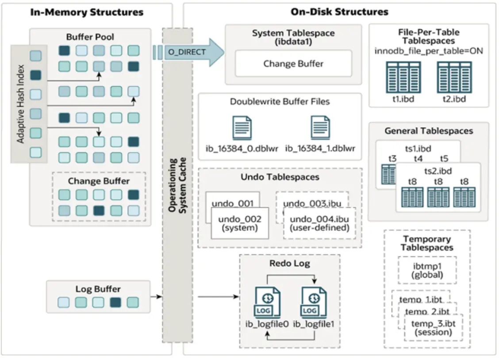

##### 内存架构


在左侧的内存结构中，主要分为这么四大块儿： Buffer Pool、Change Buffer、Adaptive Hash Index、Log Buffer。 下来介绍一下这四个部分。

**1.Buffer Pool**
InnoDB存储引擎基于磁盘文件存储，访问物理硬盘和在内存中进行访问，速度相差很大，为了尽可能弥补这两者之间的I/O效率的差值，就需要把经常使用的数据加载到缓冲池中，避免每次访问都进行磁盘I/O。

在InnoDB的缓冲池中不仅缓存了索引页和数据页，还包含了undo页、插入缓存、自适应哈希索引以及InnoDB的锁信息等等。

缓冲池 Buffer Pool，是主内存中的一个区域，里面可以缓存磁盘上经常操作的真实数据，在执行增 删改查操作时，先操作缓冲池中的数据（若缓冲池没有数据，则从磁盘加载并缓存），然后再以一定频 率刷新到磁盘，从而减少磁盘IO，加快处理速度。

缓冲池以Page页为单位，底层采用链表数据结构管理Page。根据状态，将Page分为三种类型：

free page：空闲page，未被使用。
clean page：被使用page，数据没有被修改过。
dirty page：脏页，被使用page，数据被修改过，也中数据与磁盘的数据产生了不一致。
在专用服务器上，通常将多达80％的物理内存分配给缓冲池 。参数设置： show variables like 'innodb_buffer_pool_size';

```sql
mysql> show variables like 'innodb_buffer_pool_size';
+-------------------------+-----------+
| Variable_name           | Value     |
+-------------------------+-----------+
| innodb_buffer_pool_size | 134217728 |
+-------------------------+-----------+
1 row in set (0.00 sec)

```

**2.Change Buffer**

Change Buffer，更改缓冲区（针对于非唯一二级索引页），在执行DML语句时，如果这些数据Page没有在Buffer Pool中，不会直接操作磁盘，而会将数据变更存在更改缓冲区 Change Buffer中，在未来数据被读取时，再将数据合并恢复到Buffer Pool中，再将合并后的数据刷新到磁盘中。

Change Buffer的意义是什么呢?

先来看一幅图，这个是二级索引的结构图：

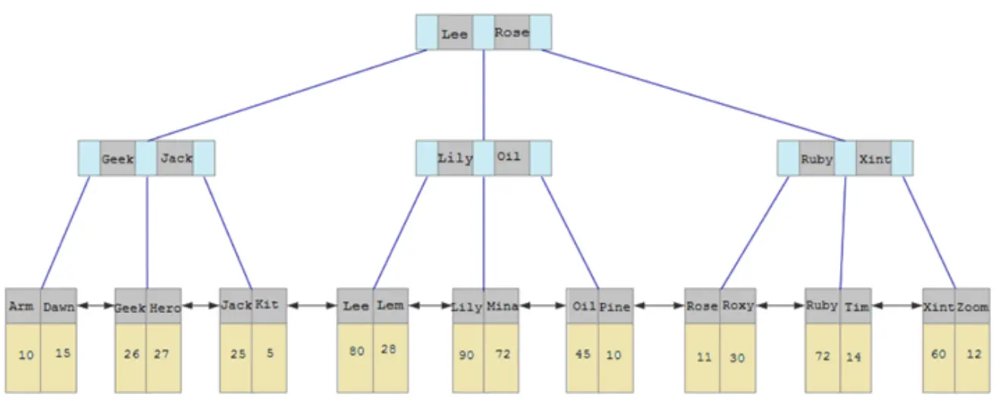

与聚集索引不同，二级索引通常是非唯一的，并且以相对随机的顺序插入二级索引。同样，删除和更新可能会影响索引树中不相邻的二级索引页，如果每一次都操作磁盘，会造成大量的磁盘IO。有了ChangeBuffer之后，我们可以在缓冲池中进行合并处理，减少磁盘IO。

**3.Adaptive Hash Index**

自适应hash索引，用于优化对Buffer Pool数据的查询。MySQL的innoDB引擎中虽然没有直接支持hash索引，但是给我们提供了一个功能就是这个自适应hash索引。因为前面我们讲到过，hash索引在进行等值匹配时，一般性能是要高于B+树的，因为hash索引一般只需要一次IO即可，而B+树，可能需要几次匹配，所以hash索引的效率要高，但是hash索引又不适合做范围查询、模糊匹配等。

InnoDB存储引擎会监控对表上各索引页的查询，如果观察到在特定的条件下hash索引可以提升速度，则建立hash索引，称之为自适应hash索引。

**自适应哈希索引，无需人工干预，是系统根据情况自动完成**。

参数： `adaptive_hash_index`

**4.Log Buffer**

Log Buffer：日志缓冲区，用来保存要写入到磁盘中的log日志数据（redo log 、undo log），默认大小为 16MB，日志缓冲区的日志会定期刷新到磁盘中。如果需要更新、插入或删除许多行的事务，增加日志缓冲区的大小可以节省磁盘 I/O。

参数:

innodb_log_buffer_size：缓冲区大小

innodb_flush_log_at_trx_commit：日志刷新到磁盘时机，取值主要包含以下三个：

 `1`:日志在每次事务提交时写入并刷新到磁盘，默认值。

 `0`:每秒将日志写入并刷新到磁盘一次。

 `2`:日志在每次事务提交后写入，并每秒刷新到磁盘一次。

```sql
mysql> show variables like 'innodb_flush_log_at_trx_commit';
+--------------------------------+-------+
| Variable_name                  | Value |
+--------------------------------+-------+
| innodb_flush_log_at_trx_commit | 1     |
+--------------------------------+-------+
1 row in set (0.00 sec)

```

##### 磁盘结构

接下来，再来看看InnoDB体系结构的右边部分，也就是磁盘结构：

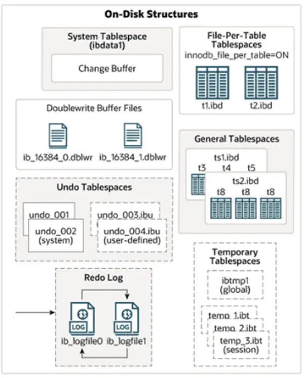

**1.System Tablespace**

系统表空间是更改缓冲区的存储区域。如果表是在系统表空间而不是每个表文件或通用表空间中创建的，它也可能包含表和索引数据。(在MySQL5.x版本中还包含InnoDB数据字典、undolog等)

参数：innodb_data_file_path

```sql
mysql> show variables like 'innodb_data_file_path';
+-----------------------+------------------------+
| Variable_name         | Value                  |
+-----------------------+------------------------+
| innodb_data_file_path | ibdata1:12M:autoextend |
+-----------------------+------------------------+
1 row in set (0.00 sec)

```

系统表空间，默认的文件名叫 ibdata1。

**2.File-Per-Table Tablespaces**

如果开启了innodb_file_per_table开关 ，则每个表的文件表空间包含单个InnoDB表的数据和索引 ，并存储在文件系统上的单个数据文件中。

开关参数：`innodb_file_per_table`，该参数默认开启。

```sql
mysql> show variables like 'innodb_file_per_table';
+-----------------------+-------+
| Variable_name         | Value |
+-----------------------+-------+
| innodb_file_per_table | ON    |
+-----------------------+-------+
1 row in set (0.00 sec)

```

那也就是说，我们每创建一个表，都会产生一个表空间文件，如图：


**3.General Tablespaces**

通用表空间，需要通过 CREATE TABLESPACE 语法创建通用表空间，在创建表时，可以指定该表空间。

A. 创建表空间

```sql
CREATE TABLESPACE ts_name ADD DATAFILE 'file_name' ENGINE = engine_name;

```

```sql
mysql> CREATE TABLESPACE ts_itheima ADD DATAFILE 'myitheima.ibd' ENGINE = innodb;
Query OK, 0 rows affected (0.00 sec)

```

B. 创建表时指定表空间

```sql
CREATE TABLE xxx ... TABLESPACE ts_name;

```

```sql
mysql> create table a(id int primary key auto_increment,name varchar(10)) engine=innodb tablespace ts_itheima;
Query OK, 0 rows affected (0.01 sec)

```

**4.Undo Tablespaces**

撤销表空间，MySQL实例在初始化时会自动创建两个默认的undo表空间（初始大小16M），用于存储 undo log日志。

**5.Temporary Tablespaces**

InnoDB 使用会话临时表空间和全局临时表空间。存储用户创建的临时表等数据。

**6.Doublewrite Buffer Files**

双写缓冲区，innoDB引擎将数据页从Buffer Pool刷新到磁盘前，先将数据页写入双写缓冲区文件中，便于系统异常时恢复数据。

**7.Redo Log**

重做日志，是用来实现事务的持久性。该日志文件由两部分组成：重做日志缓冲（redo log buffer）以及重做日志文件（redo log）,前者是在内存中，后者在磁盘中。当事务提交之后会把所有修改信息都会存到该日志中, 用于在刷新脏页到磁盘时,发生错误时, 进行数据恢复使用。

以循环方式写入重做日志文件，涉及两个文件：

```sql
-rw-r-----. 1 mysql mysql  50331648 10月  2 22:52 ib_logfile0
-rw-r-----. 1 mysql mysql  50331648 10月  2 22:52 ib_logfile1

```

前面我们介绍了InnoDB的内存结构，以及磁盘结构，那么内存中我们所更新的数据，又是如何到磁盘中的呢？ 此时，就涉及到一组后台线程，接下来，就来介绍一些InnoDB中涉及到的后台线程。

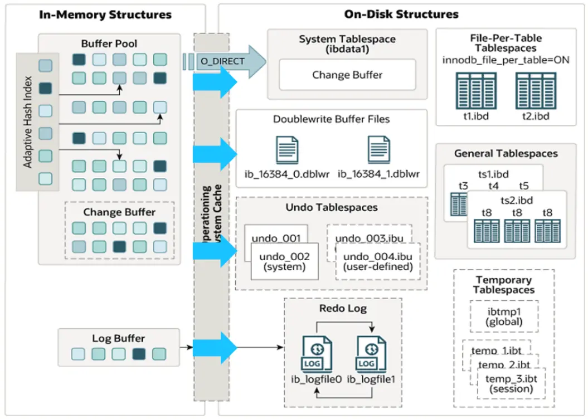

##### 后台线程

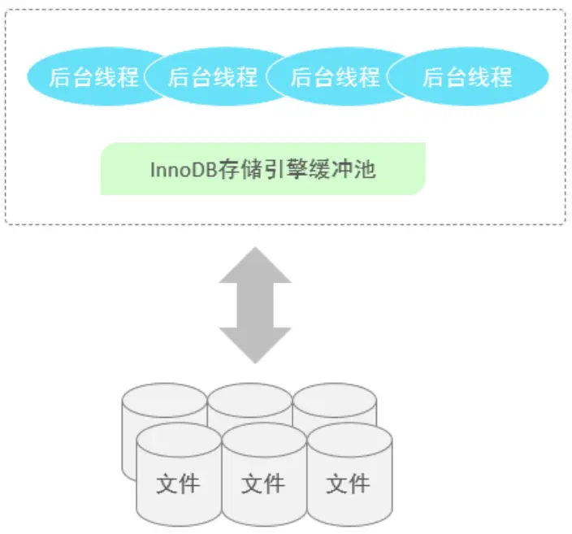

在InnoDB的后台线程中，分为4类，分别是：Master Thread 、IO Thread、Purge Thread、Page Cleaner Thread。

**1.Master Thread**

核心后台线程，负责调度其他线程，还负责将缓冲池中的数据异步刷新到磁盘中, 保持数据的一致性，还包括脏页的刷新、合并插入缓存、undo页的回收 。

**2.IO Thread**

在InnoDB存储引擎中大量使用了AIO来处理IO请求, 这样可以极大地提高数据库的性能，而IOThread主要负责这些IO请求的回调。

| **线程类型**         | 默认个数 | **职责**                     |
| -------------------- | -------- | ---------------------------- |
| Read thread          | 4        | 负责读操作                   |
| Write thread         | 4        | 负责写操作                   |
| Log thread           | 1        | 负责将日志缓冲区刷新到磁盘   |
| Insert buffer thread | 1        | 负责将写缓冲区内容刷新到磁盘 |

我们可以通过以下的这条指令，查看到InnoDB的状态信息，其中就包含IO Thread信息。

```
show engine innodb status;

```

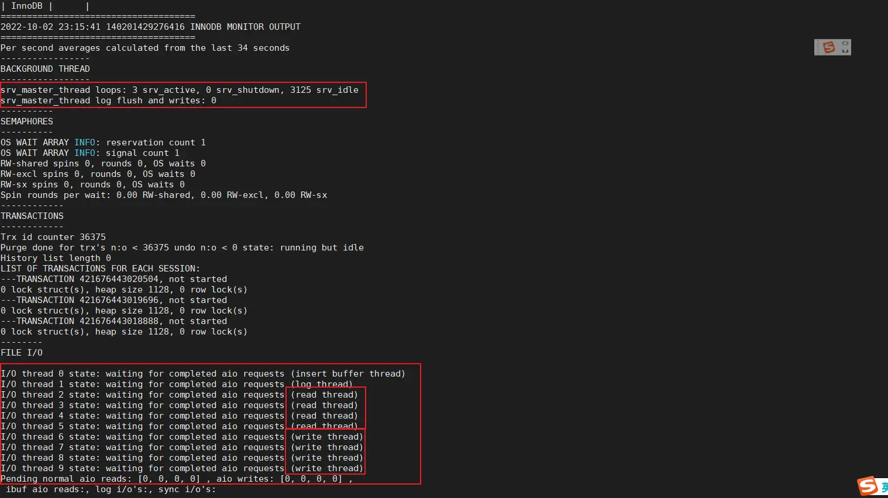

**3.Purge Thread**

主要用于回收事务已经提交了的undo log，在事务提交之后，undo log可能不用了，就用它来回收。

**4.Page Cleaner Thread**

协助 Master Thread 刷新脏页到磁盘的线程，它可以减轻 Master Thread 的工作压力，减少阻塞。

#### 事务原理

##### 事务基础

1.事务

事务 是一组操作的集合，它是一个不可分割的工作单位，事务会把所有的操作作为一个整体一起向系统提交或撤销操作请求，即这些操作要么同时成功，要么同时失败。

2.特性

- 原子性（Atomicity）：事务是不可分割的最小操作单元，要么全部成功，要么全部失败。
- 一致性（Consistency）：事务完成时，必须使所有的数据都保持一致状态。
- 隔离性（Isolation）：数据库系统提供的隔离机制，保证事务在不受外部并发操作影响的独立环境下运行。
- 持久性（Durability）：事务一旦提交或回滚，它对数据库中的数据的改变就是永久的。

那实际上，我们研究事务的原理，就是研究MySQL的InnoDB引擎是如何保证事务的这四大特性的。


而对于这四大特性，实际上分为两个部分。 其中的原子性、一致性、持久化，实际上是由InnoDB中的两份日志来保证的，一份是redo log日志，一份是undo log日志。 而持久性是通过数据库的锁，加上MVCC来保证的。


##### redo log

重做日志，记录的是事务提交时数据页的物理修改，是用来实现事务的持久性。

该日志文件由两部分组成：重做日志缓冲（redo log buffer）以及重做日志文件（redo log file）,前者是在内存中，后者在磁盘中。当事务提交之后会把所有修改信息都存到该日志文件中, 用于在刷新脏页到磁盘,发生错误时, 进行数据恢复使用。

如果没有redolog，可能会存在什么问题的？ 我们一起来分析一下。

我们知道，在InnoDB引擎中的内存结构中，主要的内存区域就是缓冲池，在缓冲池中缓存了很多的数据页。 当我们在一个事务中，执行多个增删改的操作时，InnoDB引擎会先操作缓冲池中的数据，如果缓冲区没有对应的数据，会通过后台线程将磁盘中的数据加载出来，存放在缓冲区中，然后将缓冲池中的数据修改，修改后的数据页我们称为脏页。 而脏页则会在一定的时机，通过后台线程刷新到磁盘中，从而保证缓冲区与磁盘的数据一致。 而缓冲区的脏页数据并不是实时刷新的，而是一段时间之后将缓冲区的数据刷新到磁盘中，假如刷新到磁盘的过程出错了，而提示给用户事务提交成功，而数据却没有持久化下来，这就出现问题了，没有保证事务的持久性。

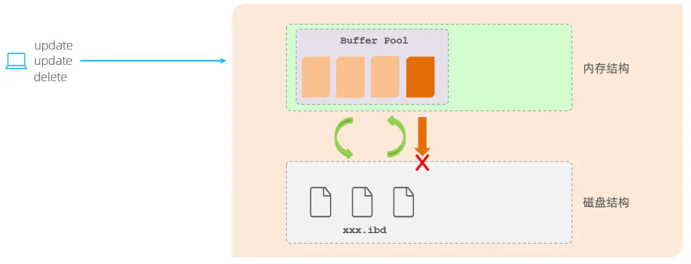

那么，如何解决上述的问题呢？ 在InnoDB中提供了一份日志 redo log，接下来我们再来分析一下，通过redolog如何解决这个问题。

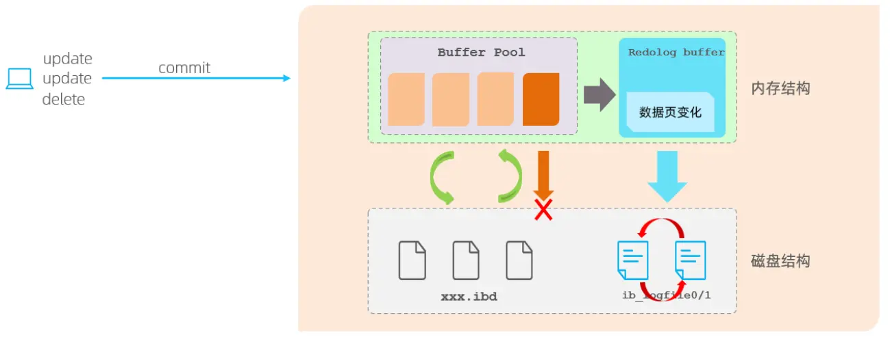

有了redolog之后，当对缓冲区的数据进行增删改之后，会首先将操作的数据页的变化，记录在redo log buffer中。在事务提交时，会将redo log buffer中的数据刷新到redo log磁盘文件中。过一段时间之后，如果刷新缓冲区的脏页到磁盘时，**发生错误，此时就可以借助于redo log进行数据恢复，这样就保证了事务的持久性。** 而如果脏页成功刷新到磁盘 或 或者涉及到的数据已经落盘，此时redolog就没有作用了，就可以删除了，所以存在的两个redolog文件是循环写的。

那为什么每一次提交事务，要刷新redo log 到磁盘中呢，而不是直接将buffer pool中的脏页刷新到磁盘呢 ?

因为在业务操作中，**我们操作数据一般都是随机读写磁盘的，而不是顺序读写磁盘。 而redo log在往磁盘文件中写入数据，由于是日志文件，所以都是顺序写的。顺序写的效率，要远大于随机写。** 这种先写日志的方式，称之为 WAL（Write-Ahead Logging）。

##### undo log

回滚日志，用于记录数据被修改前的信息 , 作用包含两个 : 提供回滚(保证事务的原子性) 和MVCC(多版本并发控制) 。

undo log和redo log记录物理日志不一样，它是逻辑日志。可以认为当delete一条记录时，undolog中会记录一条对应的insert记录，反之亦然，当update一条记录时，它记录一条对应相反的update记录。当执行rollback时，就可以从undo log中的逻辑记录读取到相应的内容并进行回滚。

Undo log销毁：undo log在事务执行时产生，事务提交时，并不会立即删除undo log，因为这些日志可能还用于MVCC。

Undo log存储：undo log采用段的方式进行管理和记录，存放在前面介绍的 rollback segment回滚段中，内部包含1024个undo log segment。

#### MVCC

##### 基本概念

1.当前读

读取的是记录的最新版本，读取时还要保证其他并发事务不能修改当前记录，会对读取的记录进行加锁。对于我们日常的操作，如：`select ... lock in share mode`(共享锁)，`select ...for update`、`update`、`insert`、`delete`(排他锁)都是一种当前读。

测试:

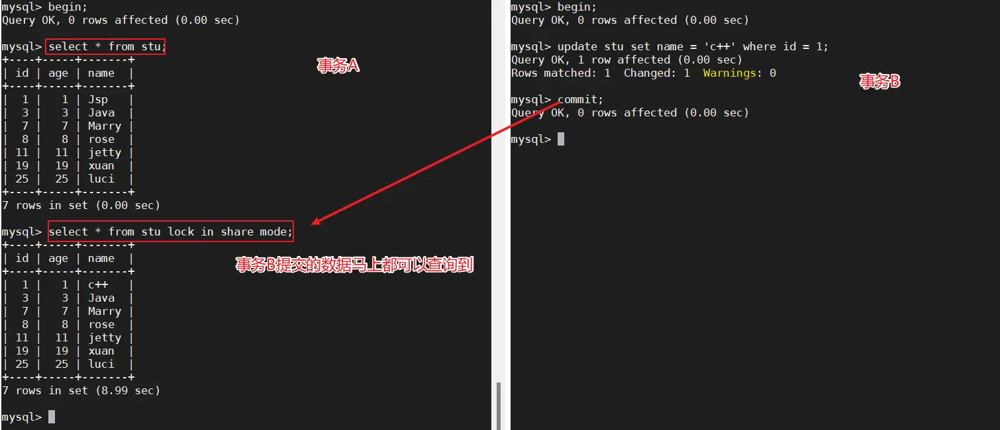

在测试中我们可以看到，即使是在默认的RR隔离级别下，事务A中依然可以读取到事务B最新提交的内容，因为在查询语句后面加上了 `lock in share mode` 共享锁，此时是当前读操作。当然，当我们加排他锁的时候，也是当前读操作。

2.快照读

简单的select（不加锁）就是快照读，快照读，读取的是记录数据的可见版本，有可能是历史数据，不加锁，是非阻塞读。

- Read Committed：每次select，都生成一个快照读。
- Repeatable Read：开启事务后第一个select语句才是快照读的地方。
- Serializable：快照读会退化为当前读。

测试:

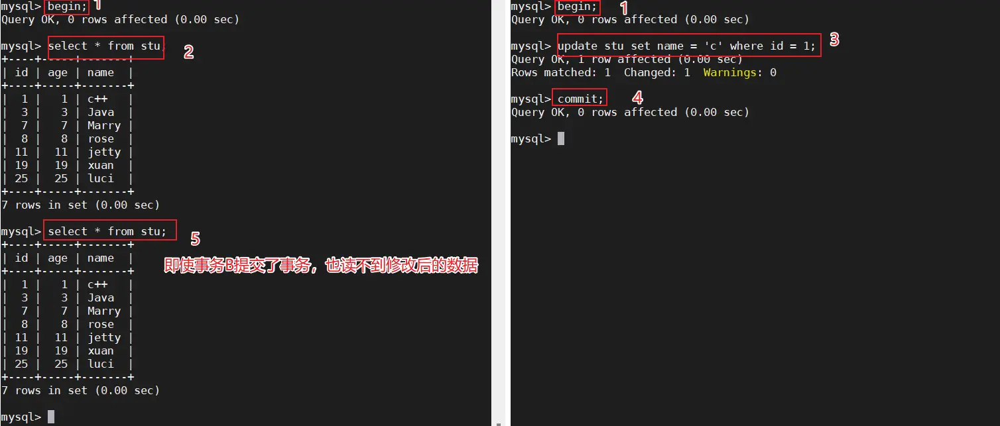

在测试中,我们看到即使事务B提交了数据,事务A中也查询不到。 原因就是因为普通的select是快照读，而在当前默认的RR隔离级别下，开启事务后第一个select语句才是快照读的地方，后面执行相同的select语句都是从快照中获取数据，可能不是当前的最新数据，这样也就保证了可重复读。

3.MVCC

全称 Multi-Version Concurrency Control，多版本并发控制。指维护一个数据的多个版本，使得读写操作没有冲突，快照读为MySQL实现MVCC提供了一个非阻塞读功能。MVCC的具体实现，还需要依赖于数据库记录中的三个隐式字段、undo log日志、readView。

接下来，我们再来介绍一下InnoDB引擎的表中涉及到的隐藏字段 、undolog 以及 readview，从而来介绍一下MVCC的原理。

##### 隐藏字段

介绍：

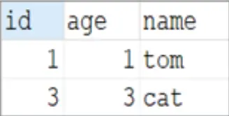

当我们创建了上面的这张表，我们在查看表结构的时候，就可以显式的看到这三个字段。 实际上除了这三个字段以外，InnoDB还会自动的给我们添加三个隐藏字段及其含义分别是：

| **隐藏字段** | **含义**                                                     |
| ------------ | ------------------------------------------------------------ |
| DB_TRX_ID    | 最近修改事务ID，记录插入这条记录或最后一次修改该记录的事务ID |
| DB_ROLL_PTR  | 回滚指针，指向这条记录的上一个版本，用于配合undo log，指向上一个版本 |
| DB_ROW_ID    | 隐藏主键，如果表结构没有指定主键，将会生成该隐藏字段         |

而上述的前两个字段是肯定会添加的， 是否添加最后一个字段DB_ROW_ID，得看当前表有没有主键，如果有主键，则不会添加该隐藏字段。

测试：

1.查看有主键的表 stu

进入服务器中的 /var/lib/mysql/MySQL_Advanced/ , 查看stu的表结构信息, 通过如下指令:

```sql
ibd2sdi stu.ibd

```

查看到的表结构信息中，有一栏 columns，在其中我们会看到处理我们建表时指定的字段以外，还有额外的两个字段 分别是：DB_TRX_ID 、 DB_ROLL_PTR ，因为该表有主键，所以没有DB_ROW_ID隐藏字段。

```sql
            {
                "name": "DB_TRX_ID",
                "type": 10,
                "is_nullable": false,
                "is_zerofill": false,
                "is_unsigned": false,
                "is_auto_increment": false,
                "is_virtual": false,
                "hidden": 2,
                "ordinal_position": 4,
                "char_length": 6,
                "numeric_precision": 0,
                "numeric_scale": 0,
                "numeric_scale_null": true,
                "datetime_precision": 0,
                "datetime_precision_null": 1,
                "has_no_default": false,
                "default_value_null": true,
                "srs_id_null": true,
                "srs_id": 0,
                "default_value": "",
                "default_value_utf8_null": true,
                "default_value_utf8": "",
                "default_option": "",
                "update_option": "",
                "comment": "",
                "generation_expression": "",
                "generation_expression_utf8": "",
                "options": "",
                "se_private_data": "table_id=1074;",
                "engine_attribute": "",
                "secondary_engine_attribute": "",
                "column_key": 1,
                "column_type_utf8": "",
                "elements": [],
                "collation_id": 63,
                "is_explicit_collation": false
            },
            {
                "name": "DB_ROLL_PTR",
                "type": 9,
                "is_nullable": false,
                "is_zerofill": false,
                "is_unsigned": false,
                "is_auto_increment": false,
                "is_virtual": false,
                "hidden": 2,
                "ordinal_position": 5,
                "char_length": 7,
                "numeric_precision": 0,
                "numeric_scale": 0,
                "numeric_scale_null": true,
                "datetime_precision": 0,
                "datetime_precision_null": 1,
                "has_no_default": false,
                "default_value_null": true,
                "srs_id_null": true,
                "srs_id": 0,
                "default_value": "",
                "default_value_utf8_null": true,
                "default_value_utf8": "",
                "default_option": "",
                "update_option": "",
                "comment": "",
                "generation_expression": "",
                "generation_expression_utf8": "",
                "options": "",
                "se_private_data": "table_id=1074;",
                "engine_attribute": "",
                "secondary_engine_attribute": "",
                "column_key": 1,
                "column_type_utf8": "",
                "elements": [],
                "collation_id": 63,
                "is_explicit_collation": false
            }

```

2.查看没有主键的表 employee

建表语句：

```sql
create table employee (id int , name varchar(10));

```

此时，我们再通过以下指令来查看表结构及其其中的字段信息：

```sql
ibd2sdi employee.ibd

```

查看到的表结构信息中，有一栏 columns，在其中我们会看到处理我们建表时指定的字段以外，还有额外的三个字段 分别是：DB_TRX_ID 、 DB_ROLL_PTR 、DB_ROW_ID，因为employee表是没有指定主键的。

```sql
            {
                "name": "DB_ROW_ID",
                "type": 10,
                "is_nullable": false,
                "is_zerofill": false,
                "is_unsigned": false,
                "is_auto_increment": false,
                "is_virtual": false,
                "hidden": 2,
                "ordinal_position": 3,
                "char_length": 6,
                "numeric_precision": 0,
                "numeric_scale": 0,
                "numeric_scale_null": true,
                "datetime_precision": 0,
                "datetime_precision_null": 1,
                "has_no_default": false,
                "default_value_null": true,
                "srs_id_null": true,
                "srs_id": 0,
                "default_value": "",
                "default_value_utf8_null": true,
                "default_value_utf8": "",
                "default_option": "",
                "update_option": "",
                "comment": "",
                "generation_expression": "",
                "generation_expression_utf8": "",
                "options": "",
                "se_private_data": "table_id=1076;",
                "engine_attribute": "",
                "secondary_engine_attribute": "",
                "column_key": 1,
                "column_type_utf8": "",
                "elements": [],
                "collation_id": 63,
                "is_explicit_collation": false
            },
            {
                "name": "DB_TRX_ID",
                "type": 10,
                "is_nullable": false,
                "is_zerofill": false,
                "is_unsigned": false,
                "is_auto_increment": false,
                "is_virtual": false,
                "hidden": 2,
                "ordinal_position": 4,
                "char_length": 6,
                "numeric_precision": 0,
                "numeric_scale": 0,
                "numeric_scale_null": true,
                "datetime_precision": 0,
                "datetime_precision_null": 1,
                "has_no_default": false,
                "default_value_null": true,
                "srs_id_null": true,
                "srs_id": 0,
                "default_value": "",
                "default_value_utf8_null": true,
                "default_value_utf8": "",
                "default_option": "",
                "update_option": "",
                "comment": "",
                "generation_expression": "",
                "generation_expression_utf8": "",
                "options": "",
                "se_private_data": "table_id=1076;",
                "engine_attribute": "",
                "secondary_engine_attribute": "",
                "column_key": 1,
                "column_type_utf8": "",
                "elements": [],
                "collation_id": 63,
                "is_explicit_collation": false
            },
            {
                "name": "DB_ROLL_PTR",
                "type": 9,
                "is_nullable": false,
                "is_zerofill": false,
                "is_unsigned": false,
                "is_auto_increment": false,
                "is_virtual": false,
                "hidden": 2,
                "ordinal_position": 5,
                "char_length": 7,
                "numeric_precision": 0,
                "numeric_scale": 0,
                "numeric_scale_null": true,
                "datetime_precision": 0,
                "datetime_precision_null": 1,
                "has_no_default": false,
                "default_value_null": true,
                "srs_id_null": true,
                "srs_id": 0,
                "default_value": "",
                "default_value_utf8_null": true,
                "default_value_utf8": "",
                "default_option": "",
                "update_option": "",
                "comment": "",
                "generation_expression": "",
                "generation_expression_utf8": "",
                "options": "",
                "se_private_data": "table_id=1076;",
                "engine_attribute": "",
                "secondary_engine_attribute": "",
                "column_key": 1,
                "column_type_utf8": "",
                "elements": [],
                "collation_id": 63,
                "is_explicit_collation": false
            }
        ],

```

##### undo log

介绍：

回滚日志，在insert、update、delete的时候产生的便于数据回滚的日志。

当insert的时候，产生的undo log日志只在回滚时需要，在事务提交后，可被立即删除。

而update、delete的时候，产生的undo log日志不仅在回滚时需要，在快照读时也需要，不会立即被删除。

版本链：

有一张表原始数据为：

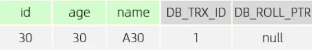

> `DB_TRX_ID` : 代表最近修改事务ID，记录插入这条记录或最后一次修改该记录的事务ID，是自增的。
>
> `DB_ROLL_PTR`： 由于这条数据是才插入的，没有被更新过，所以该字段值为null。

然后，有四个并发事务同时在访问这张表。

A. 第一步

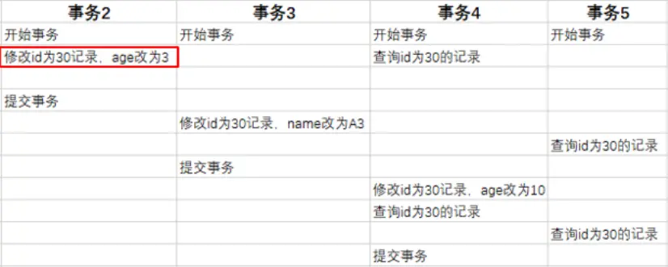

当事务2执行第一条修改语句时，会记录undo log日志，记录数据变更之前的样子; 然后更新记录，并且记录本次操作的事务ID，回滚指针，回滚指针用来指定如果发生回滚，回滚到哪一个版本。

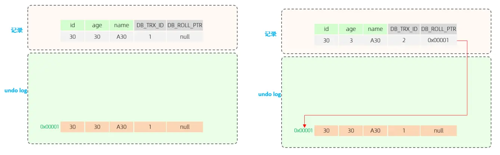

B.第二步

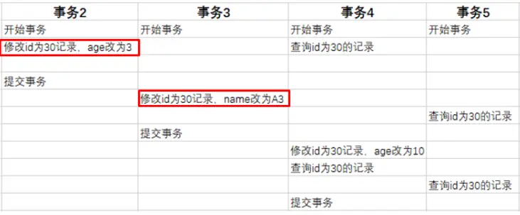

当事务3执行第一条修改语句时，也会记录undo log日志，记录数据变更之前的样子; 然后更新记录，并且记录本次操作的事务ID，回滚指针，回滚指针用来指定如果发生回滚，回滚到哪一个版本。

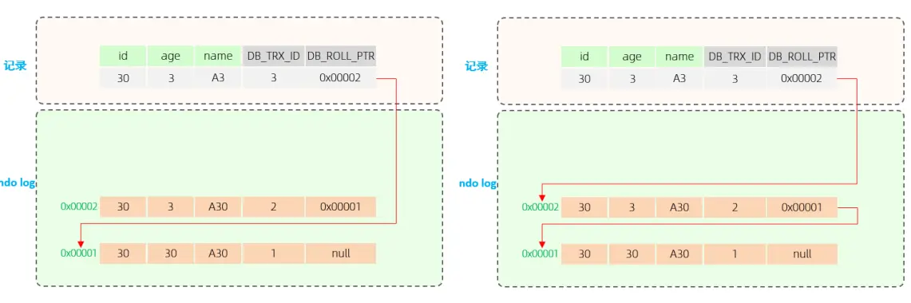

C. 第三步

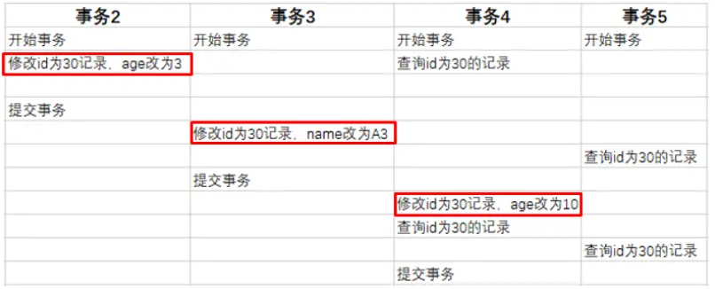

当事务4执行第一条修改语句时，也会记录undo log日志，记录数据变更之前的样子; 然后更新记录，并且记录本次操作的事务ID，回滚指针，回滚指针用来指定如果发生回滚，回滚到哪一个版本。

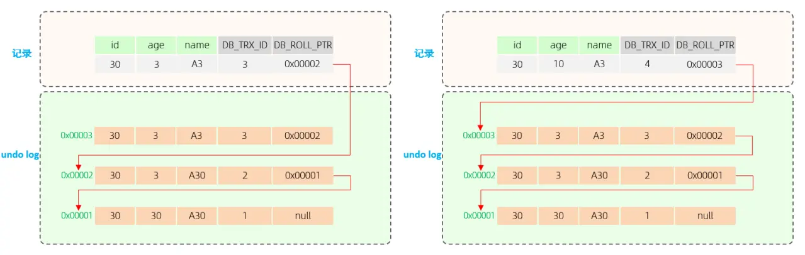

> 最终我们发现，不同事务或相同事务对同一条记录进行修改，会导致该记录的undolog生成一条记录版本链表，链表的头部是最新的旧记录，链表尾部是最早的旧记录。

##### read view

ReadView（读视图）是 快照读 SQL执行时MVCC提取数据的依据，记录并维护系统当前活跃的事务（未提交的）id。

ReadView中包含了四个核心字段：

| **字段**       | **含义**                                             |
| -------------- | ---------------------------------------------------- |
| m_ids          | 当前活跃的事务ID集合                                 |
| min_trx_id     | 最小活跃事务ID                                       |
| max_trx_id     | 预分配事务ID，当前最大事务ID+1（因为事务ID是自增的） |
| creator_trx_id | ReadView创建者的事务ID                               |

而在readview中就规定了版本链数据的访问规则：

trx_id 代表当前undolog版本链对应事务ID。

| **条件**                           | **是否可以访问**                          | **说明**                                 |
| ---------------------------------- | ----------------------------------------- | ---------------------------------------- |
| trx_id == creator_trx_id           | 可以访问该版本                            | 成立，说明数据是当前这个事务更改的       |
| trx_id < min_trx_id                | 可以访问该版本                            | 成立，说明数据已经提交了                 |
| trx_id > max_trx_id                | 不可以访问该版本                          | 成立，说明该事务是在ReadView生成后才开启 |
| min_trx_id <= trx_id <= max_trx_id | 如果trx_id不在m_ids中，是可以访问该版本的 | 成立，说明数据已经提交                   |

不同的隔离级别，生成ReadView的时机不同：

- READ COMMITTED ：在事务中每一次执行快照读时生成ReadView。
- REPEATABLE READ：仅在事务中第一次执行快照读时生成ReadView，后续复用该ReadView。

##### 原理分析

###### RC隔离级别

RC隔离级别下，在事务中**每一次**执行快照读时生成ReadView。

我们就来分析事务5中，两次快照读读取数据，是如何获取数据的?

在事务5中，查询了两次id为30的记录，由于隔离级别为Read Committed，所以每一次进行快照读都会生成一个ReadView，那么两次生成的ReadView如下。

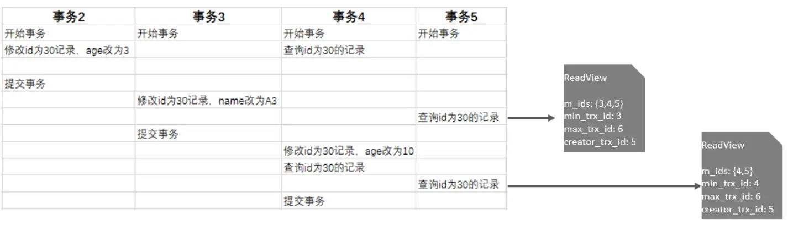

那么这两次快照读在获取数据时，就需要根据所生成的ReadView以及ReadView的版本链访问规则，到undolog版本链中匹配数据，最终决定此次快照读返回的数据。

A. 先来看第一次快照读具体的读取过程：

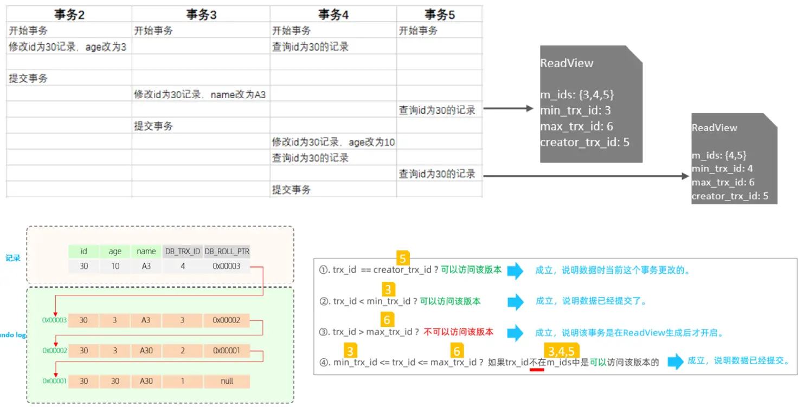

在进行匹配时，会从undo log的版本链，从上到下进行挨个匹配：

- 先匹配

  

  这条记录，这条记录对应的trx_id为4，也就是将4带入右侧的匹配规则中。 ①不满足 ②不满足 ③不满足 ④也不满足 ，都不满足，则继续匹配undo log版本链的下一条。

- 再匹配第二条

  

  这条记录对应的trx_id为3，也就是将3带入右侧的匹配规则中。①不满足 ②不满足 ③不满足 ④也不满足 ，都不满足，则继续匹配undo log版本链的下一条。

- 再匹配第三条

  

  这条记录对应的trx_id为2，也就是将2带入右侧的匹配规则中。①不满足 ②满足 终止匹配，此次快照读，返回的数据就是版本链中记录的这条数据。


B. 再来看第二次快照读具体的读取过程:

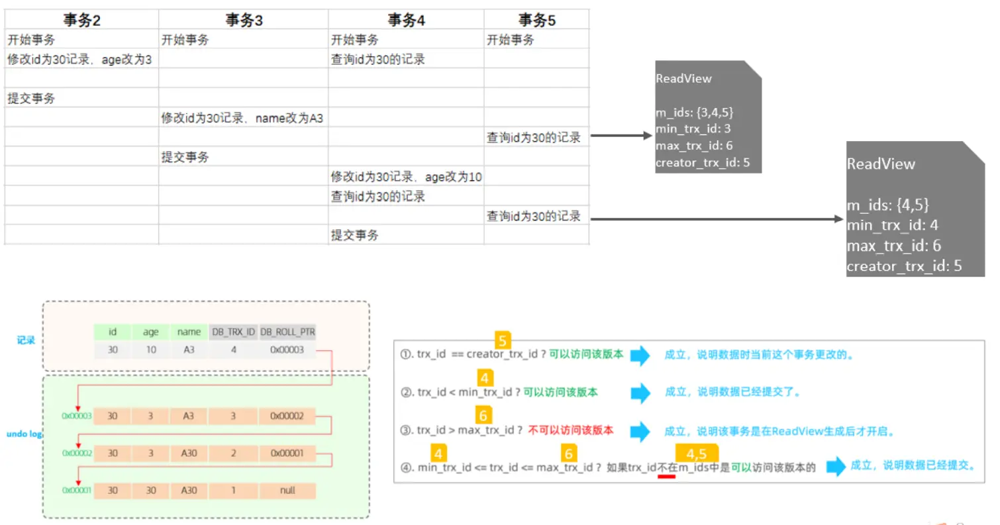

在进行匹配时，会从undo log的版本链，从上到下进行挨个匹配：

- 先匹配

  

  这条记录，这条记录对应的trx_id为4，也就是将4带入右侧的匹配规则中。 ①不满足 ②不满足 ③不满足 ④也不满足 ，都不满足，则继续匹配undo log版本链的下一条。

- 再匹配第二条

  

  这条记录对应的trx_id为3，也就是将3带入右侧的匹配规则中。①不满足 ②满足 。终止匹配，此次快照读，返回的数据就是版本链中记录的这条数据。

###### RR隔离级别

RR隔离级别下，仅在事务中第一次执行快照读时生成ReadView，后续复用该ReadView。 而RR 是可重复读，在一个事务中，执行两次相同的select语句，查询到的结果是一样的。

那MySQL是如何做到可重复读的呢? 我们简单分析一下就知道了

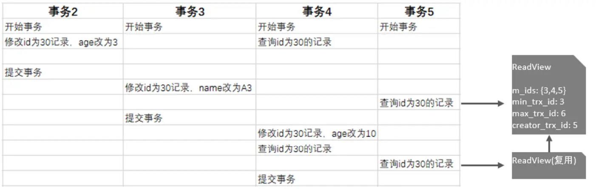

我们看到，在RR隔离级别下，只是在事务中**第一次**快照读时生成ReadView，后续都是复用该ReadView，那么既然ReadView都一样， ReadView的版本链匹配规则也一样， 那么最终快照读返回的结果也是一样的。

所以呢，MVCC的实现原理就是通过 InnoDB表的隐藏字段、UndoLog 版本链、ReadView来实现的。而MVCC + 锁，则实现了事务的隔离性。 而一致性则是由redolog 与 undolog保证。


