# Spring 概述

## Spring 简介

- 春天 ：给软件行业带来春天
- 2002 年，Rod Johnson 首次推出了 Spring 的框架雏形 interface21 框架
- 2004 年 3.24，Spring 框架以 interface21 为基础，经过重新设计，发布了 1.0 正式版
- Rod Johnson 是悉尼大学音乐学博士
- Spring 理念：使现有的技术更加实用，大杂烩，整合了现有的技术框架

官网 : http://spring.io/

官方下载地址 : https://repo.spring.io/libs-release-local/org/springframework/spring/

GitHub : https://github.com/spring-projects

## Spring 优点

- Spring 是一个开源免费的框架、容器
- Spring 是一个轻量级的、非侵入式的框架
- IOC（控制反转）、AOP（面向切面）
- 支持事务与框架

总结：**Spring 是一个轻量级的控制反转（IOC）和面向切面（AOP）的容器（框架）**

## Spring 的组成

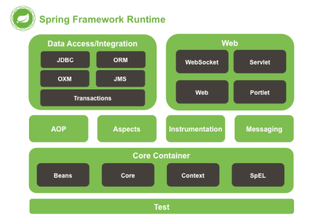
Spring 框架是一个分层结构，由 7 个定义良好的接口组成。Spring 模块构建在核心容器之上，核心容器定义了创建、配置和管理 bean 的方式

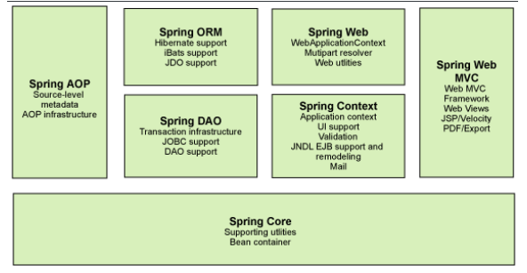

组成 Spring 框架的每个模块（或组件）都可以单独存在，或者与其他一个或多个模块联合实现，每个模块的功能如下：

- **核心容器**：核心容器提供 Spring 框架的基本功能。核心容器的主要组件是 `BeanFactory`，它是工厂模式的实现。`BeanFactory` 使用控制反转（IOC） 模式将应用程序的配置和依赖性规范与实际的应用程序代码分开。
- Spring 上下文：Spring 上下文是一个配置文件，向 Spring 框架提供上下文信息。Spring 上下文包括企业服务，例如 JNDI、EJB、电子邮件、国际化、校验和调度功能。
- Spring AOP：通过配置管理特性，Spring AOP 模块直接将面向切面的编程功能 , 集成到了 Spring 框架中。所以，可以很容易地使 Spring 框架管理任何支持 AOP 的对象。Spring AOP 模块为基于 Spring 的应用程序中的对象提供了事务管理服务。通过使用 Spring AOP，不用依赖组件，就可以将声明性事务管理集成到应用程序中。
- Spring DAO：JDBC DAO 抽象层提供了有意义的异常层次结构，可用该结构来管理异常处理和不同数据库供应商抛出的错误消息。异常层次结构简化了错误处理，并且极大地降低了需要编写的异常代码数量（例如打开和关闭连接）。Spring DAO 的面向 JDBC 的异常遵从通用的 DAO 异常层次结构。
- Spring ORM：Spring 框架插入了若干个 ORM 框架，从而提供了 ORM 的对象关系工具，其中包括 JDO、Hibernate 和 iBatis SQL Map。所有这些都遵从 Spring 的通用事务和 DAO 异常层次结构。
- Spring Web 模块：Web 上下文模块建立在应用程序上下文模块之上，为基于 Web 的应用程序提供了上下文。所以，Spring 框架支持与 Jakarta Struts 的集成。Web 模块还简化了处理多部分请求以及将请求参数绑定到域对象的工作。
- Spring MVC 框架：MVC 框架是一个全功能的构建 Web 应用程序的 MVC 实现。通过策略接口，MVC 框架变成为高度可配置的，MVC 容纳了大量视图技术，其中包括 JSP、Velocity、Tiles、iText 和 POI。

## 拓展

Spring Boot 与 Spring Cloud

- Spring Boot 是 Spring 的一套快速配置脚手架，可以基于 Spring Boot 快速开发单个微服务
- Spring Cloud 是基于 Spring Boot 实现的
- Spring Boot 专注于快速、方便继承的单个微服务个体，Spring Cloud 关注全局的服务治理框架
- Spring Boot 使用了约束优于配置的理念，很多集成方案已经自动选择好了，能不配置就不配置，Spring Cloud 很大一部分是基于 Spring Boot 实现的，Spring Boot 可以离开 Spring Cloud 独立开发项目，但 Spring Cloud 不能离开 Spring Boot，两者是以来关系
- Spring Boot 在 Spring Cloud 中起到承上启下的作用，如果学习 Spring Cloud 必须学习 Spring Boot
  

# IOC 基础

新建一个空白的 maven 项目

## 分析实现

先写一个 UserDao 接口：

```java
public interface UserDao {
    public void getUser();
}

```

Dao 的实现类：

```java
public class UserDaoImpl implements UserDao {
    @Override
    public void getUser() {
        System.out.println("获取用户数据");
    }
}

```

UserService 的接口：

```java
public interface UserService {
    public void getUser();
}

```

service 的实现类：

```java
public class UserServiceImpl implements UserService {
    private UserDao userDao = new UserDaoImpl();
    @Override
    public void getUser() {
        userDao.getUser();
    }
}

```

测试：

```java
@Test
public void test(){
    UserService service = new UserServiceImpl();
    service.getUser();
}

```

----------修改之后---------

增加一个 UserDao 实现类：

```java
public class UserDaoMySqlImpl implements UserDao {
    @Override
    public void getUser() {
        System.out.println("MySql获取用户数据");
    }
}

```

如果想要使用这个类，就要修改 service 实现类：

```java
public class UserServiceImpl implements UserService {
    private UserDao userDao = new UserDaoMySqlImpl();
    @Override
    public void getUser() {
        userDao.getUser();
    }
}

```

如果要增加许多个 UserDao 的实现类，这种就要修改大量代码，耦合性太高

解决方法：
在需要用到 UserDao 实现类的地方，不在具体的实现类，而是留出一个接口，利用 set 将每次需要的实现类传给 service，由 service 实现类传回选择的功能

修改的 service 实现类：

```java
public class UserServiceImpl implements UserService {
    private UserDao userDao;
    // 利用set实现
    public void setUserDao(UserDao userDao) {
        this.userDao = userDao;
    }
    @Override
    public void getUser() {
        userDao.getUser();
    }
}

```

测试：

```java
@Test
public void test(){
    UserServiceImpl service = new UserServiceImpl();
    service.setUserDao( new UserDaoMySqlImpl() );
    service.getUser();
    //那我们现在又想用Oracle去实现呢
    service.setUserDao( new UserDaoOracleImpl() );
    service.getUser();
}

```

个人理解：其实就是原先由客户提出需求，开发者接收需求，根据需求修改代码将对应的功能传给客户，主动权在开发者这里； 现在是用户提出的需求可以直接返回功能，主动权在客户。相当于有没有售货员的区别

## IOC 本质

**控制反转 IOC（Inversion of Control），是一种设计思想，DI（依赖注入）是实现 IOC 的一种方法**。也有人认为 DI 知识 IOC 的另一种说法，没有 IOC 的程序中，我们使用面向对象编程，对象的创建与对象间的依赖关系完全硬编码在程序中，对象的创建对程序自己控制。控制反转后将对象的创建转移给第三方，个人认为所谓控制反转就是，获得依赖对象的方式反转了
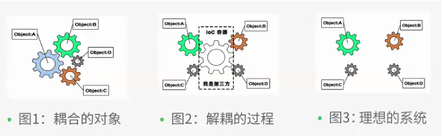
Spring 容器在初始化时先读取配置文件，根据配置文件或者元数据创建与组织对象存入容器中，程序使用时再从 IOC 容器中取出需要的对象
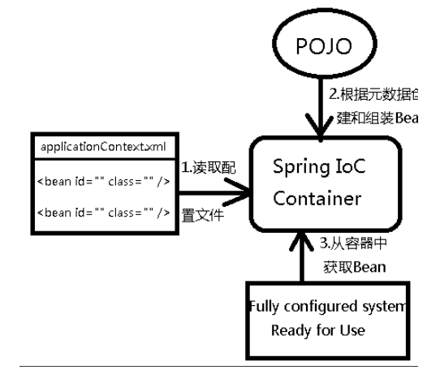
采用 XML 方式配置 Bean 的时候，Bean 的定义信息时和实现分离的，而采用注解的方式可以把两者合为一体，Bean 的定义信息直接一注解的方式定义在是啊先类中，从而达到零配置的目的

**控制反转是一种通过描述（XML 或注解）并通过第三方去生产或获取特定对象的方式。在 Spring 中实现控制反转的是 IOC 容器，他的实现方法是依赖注入（Dependency Injection，DI）。**

# Hello Spring

## 导入 jar 包

注：Spring 需要导入 commons-logging 进行日志记录，利用 maven 可以自动下载对应的依赖项

```xml
<dependency>
    <groupId>org.springframework</groupId>
    <artifactId>spring-webmvc</artifactId>
    <version>5.1.10.RELEASE</version>
</dependency>

```

## 编写代码

Hello 的实现类

```java
public class Hello {
    private String name;
    public String getName() {
        return name;
    }
    public void setName(String name) {
        this.name = name;
    }
    public void show(){
        System.out.println("Hello,"+ name );
    }
}

```

编写 spring 文件，bean.xml

```xml
<?xml version="1.0" encoding="UTF-8"?>
<beans xmlns="http://www.springframework.org/schema/beans"
       xmlns:xsi="http://www.w3.org/2001/XMLSchema-instance"
       xsi:schemaLocation="http://www.springframework.org/schema/beans
        http://www.springframework.org/schema/beans/spring-beans.xsd">
    <!--bean就是java对象 , 由Spring创建和管理-->
    <bean id="hello" class="com.kuang.pojo.Hello">
        <property name="name" value="Spring"/>
    </bean>
</beans>

```

测试

```java
@Test
public void test(){
    //解析beans.xml文件 , 生成管理相应的Bean对象
    ApplicationContext context = new ClassPathXmlApplicationContext("beans.xml");
    //getBean : 参数即为spring配置文件中bean的id .
    Hello hello = (Hello) context.getBean("hello");
    hello.show();
}

```

## 思考

- hello 对象是谁创建的？---由 Spring 创建
- hello 对象的属性怎么设置？---由 Spring 容器设置
  这个过程就叫做控制反转
- 控制：谁来控制对象的创建，传统应用程序的对象是由程序本身控制创建的，使用 Spring 后，对象由 Spring 进行创建，存储在 spring 容器中
- 反转：程序本身不创建对象，而变成被动的接收对象

依赖注入：利用 set 方法进行注入

IOC 是一种编程思想，由主动的编程变为被动的接收
可以通过 newClassPathXmlApplicationContext 去浏览底层源码

## 修改案例

XML 文件：

```xml
<?xml version="1.0" encoding="UTF-8"?>
<beans xmlns="http://www.springframework.org/schema/beans"
       xmlns:xsi="http://www.w3.org/2001/XMLSchema-instance"
       xsi:schemaLocation="http://www.springframework.org/schema/beans
        http://www.springframework.org/schema/beans/spring-beans.xsd">
    <bean id="MysqlImpl" class="com.kuang.dao.impl.UserDaoMySqlImpl"/>
    <bean id="OracleImpl" class="com.kuang.dao.impl.UserDaoOracleImpl"/>
    <bean id="ServiceImpl" class="com.kuang.service.impl.UserServiceImpl">
        <!--注意: 这里的name并不是属性 , 而是set方法后面的那部分 , 首字母小写-->
        <!--引用另外一个bean , 不是用value 而是用 ref-->
        <property name="userDao" ref="OracleImpl"/>
    </bean>
</beans>

```

测试：

```java
@Test
public void test2(){
    ApplicationContext context = new ClassPathXmlApplicationContext("beans.xml");
    UserServiceImpl serviceImpl = (UserServiceImpl) context.getBean("ServiceImpl");
    serviceImpl.getUser();
}

```

要实现不同的操作，只需要在 xml 中进行修改，IOC 简单来说就是：对象由 Spring 来进行创建、管理、装配

# IOC 创建对象方式

## 通过无参构造方法来创建

User.java

```java
public class User {
    private String name;
    public User() {
        System.out.println("user无参构造方法");
    }
    public void setName(String name) {
        this.name = name;
    }
    public void show(){
        System.out.println("name="+ name );
    }
}

```

Bean.xml

```xml
<?xml version="1.0" encoding="UTF-8"?>
<beans xmlns="http://www.springframework.org/schema/beans"
       xmlns:xsi="http://www.w3.org/2001/XMLSchema-instance"
       xsi:schemaLocation="http://www.springframework.org/schema/beans
        http://www.springframework.org/schema/beans/spring-beans.xsd">
    <bean id="user" class="com.kuang.pojo.User">
        <property name="name" value="kuangshen"/>
    </bean>
</beans>

```

测试类：

```java
@Test
public void test(){
    ApplicationContext context = new ClassPathXmlApplicationContext("beans.xml");
    //在执行getBean的时候, user已经创建好了 , 通过无参构造
    User user = (User) context.getBean("user");
    //调用对象的方法 .
    user.show();
}

```

可以发现，在 show 之前，User 对象就已经通过无参构造初始化了

## 通过有参构造来创建

UserT.java

```java
public class UserT {
    private String name;
    public UserT(String name) {
        this.name = name;
    }
    public void setName(String name) {
        this.name = name;
    }
    public void show(){
        System.out.println("name="+ name );
    }
}

```

Bean.xml(三种)

```xml
<!-- 第一种根据index参数下标设置 -->
<bean id="userT" class="com.kuang.pojo.UserT">
    <!-- index指构造方法 , 下标从0开始 -->
    <constructor-arg index="0" value="kuangshen2"/>
</bean>

```

```xml
<!-- 第二种根据参数名字设置 -->
<bean id="userT" class="com.kuang.pojo.UserT">
    <!-- name指参数名 -->
    <constructor-arg name="name" value="kuangshen2"/>
</bean>

```

```xml
<!-- 第三种根据参数类型设置 -->
<bean id="userT" class="com.kuang.pojo.UserT">
    <constructor-arg type="java.lang.String" value="kuangshen2"/>
</bean>

```

测试类：

```java
@Test
public void testT(){
    ApplicationContext context = new ClassPathXmlApplicationContext("beans.xml");
    UserT user = (UserT) context.getBean("userT");
    user.show();
}

```

在配置文件加载的时候，其中管理的对象都已经初始化了

# Spring 配置

## 别名

alias 设置别名，为 bean 设置别名，可以有多个别名

```xml
<!--设置别名：在获取Bean的时候可以使用别名获取-->
<alias name="userT" alias="userNew"/>

```

## Bean 的配置

```xml
<!--bean就是java对象,由Spring创建和管理-->
<!--
    id 是bean的标识符,要唯一,如果没有配置id,name就是默认标识符
    如果配置id,又配置了name,那么name是别名
    name可以设置多个别名,可以用逗号,分号,空格隔开
    如果不配置id和name,可以根据applicationContext.getBean(.class)获取对象;
    class是bean的全限定名=包名+类名
-->
<bean id="hello" name="hello2 h2,h3;h4" class="com.kuang.pojo.Hello">
    <property name="name" value="Spring"/>
</bean>

```

## Import

团队合作通过 import 来实现
`<import resource="{path}/beans.xml"/>`

# 依赖注入（DI）

- 依赖注入（Dependency Injection，DI）
- 依赖：指 Bena 对象的创建依赖于容器
- 注入：指 Bean 对象所依赖的资源，又容器来设置和调配

## 构造器注入

- 无参
- 有参

## set 注入（重点）

要求被注入的属性，必须有 set 方法，set 方法的方法名由 set+属性首字母大写，如果属性是 boolean 类型则没有 set 方法，而是 is

测试 pojo 类：

Address.java

```java
public class Address {
    private String address;
    public String getAddress() {
        return address;
    }
    public void setAddress(String address) {
        this.address = address;
    }
}

```

Student.java

```java
package com.kuang.pojo;
import java.util.List;
import java.util.Map;
import java.util.Properties;
import java.util.Set;
public class Student {
    private String name;
    private Address address;
    private String[] books;
    private List<String> hobbys;
    private Map<String,String> card;
    private Set<String> games;
    private String wife;
    private Properties info;
    public void setName(String name) {
        this.name = name;
    }
    public void setAddress(Address address) {
        this.address = address;
    }
    public void setBooks(String[] books) {
        this.books = books;
    }
    public void setHobbys(List<String> hobbys) {
        this.hobbys = hobbys;
    }
    public void setCard(Map<String, String> card) {
        this.card = card;
    }
    public void setGames(Set<String> games) {
        this.games = games;
    }
    public void setWife(String wife) {
        this.wife = wife;
    }
    public void setInfo(Properties info) {
        this.info = info;
    }
    public void show(){
        System.out.println("name="+ name
                + ",address="+ address.getAddress()
                + ",books="
        );
        for (String book:books){
            System.out.print("<<"+book+">>\t");
        }
        System.out.println("\n爱好:"+hobbys);
        System.out.println("card:"+card);
        System.out.println("games:"+games);
        System.out.println("wife:"+wife);
        System.out.println("info:"+info);
    }
}

```

### 常量注入

```xml
<bean id="student" class="com.kuang.pojo.Student">
    <property name="name" value="小明"/>
</bean>

```

测试

```java
@Test
public void test01(){
    ApplicationContext context = new ClassPathXmlApplicationContext("applicationContext.xml");
    Student student = (Student) context.getBean("student");
    System.out.println(student.getName());
}

```

### Bean 注入

```xml
<bean id="addr" class="com.kuang.pojo.Address">
    <property name="address" value="重庆"/>
</bean>
<bean id="student" class="com.kuang.pojo.Student">
    <property name="name" value="小明"/>
    <property name="address" ref="addr"/>
</bean>

```

### 数组注入

```xml
<bean id="student" class="com.kuang.pojo.Student">
    <property name="name" value="小明"/>
    <property name="address" ref="addr"/>
    <property name="books">
        <array>
            <value>西游记</value>
            <value>红楼梦</value>
            <value>水浒传</value>
        </array>
    </property>
</bean>

```

### List 注入

```xml
<bean id="student" class="com.kuang.pojo.Student">
    <property name="name" value="小明"/>
    <property name="address" ref="addr"/>
    <property name="books">
        <array>
            <value>西游记</value>
            <value>红楼梦</value>
            <value>水浒传</value>
        </array>
    </property>
</bean>

```

### Map 注入

```xml
<property name="card">
    <map>
        <entry key="中国邮政" value="456456456465456"/>
        <entry key="建设" value="1456682255511"/>
    </map>
</property>

```

### set 注入

```xml
<property name="games">
    <set>
        <value>LOL</value>
        <value>BOB</value>
        <value>COC</value>
    </set>
</property>

```

### NULL 注入

`<property name="wife"><null/></property>`

### Properties 注入

```xml
<property name="info">
    <props>
        <prop key="学号">20190604</prop>
        <prop key="性别">男</prop>
        <prop key="姓名">小明</prop>
    </props>
</property>

```

测试结果：
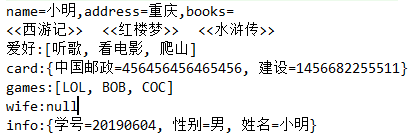

## 拓展注入现实

User.java 【没有有参构造器】

```java
public class User {
    private String name;
    private int age;
    public void setName(String name) {
        this.name = name;
    }
    public void setAge(int age) {
        this.age = age;
    }
    @Override
    public String toString() {
        return "User{" +
                "name='" + name + '\'' +
                ", age=" + age +
                '}';
    }
}

```

### P（properties）命名空间注入：需要在头文件中加入约束文件

```xml
导入约束 : xmlns:p="http://www.springframework.org/schema/p"
<!--P(属性: properties)命名空间 , 属性依然要设置set方法-->
<bean id="user" class="com.kuang.pojo.User" p:name="狂神" p:age="18"/>

```

### c（construct）命名空间注入：需要在头文件中加入约束文件

```xml
导入约束 : xmlns:c="http://www.springframework.org/schema/c"
<!--C(构造: Constructor)命名空间 , 属性依然要设置set方法-->
<bean id="user" class="com.kuang.pojo.User" c:name="狂神" c:age="18"/>

```

**未添加有参构造时报错**：相当于无参注入和有参注入

测试

```java
@Test
public void test02(){
    ApplicationContext context = new ClassPathXmlApplicationContext("applicationContext.xml");
    User user = (User) context.getBean("user");
    System.out.println(user);
}

```

## Bean 的作用域

在 Spring 中，那些组成应用程序的主体及由 Spring IoC 容器所管理的对象，被称之为 bean。简单地讲，bean 就是由 IoC 容器初始化、装配及管理的对象 .
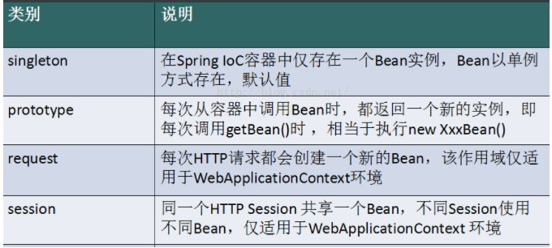
几种作用域中，request、session 作用域仅在基于 web 的应用中使用（不必关心你所采用的是什么 web 应用框架），只能用在基于 web 的 Spring ApplicationContext 环境。

### Singleton

当一个 bean 的作用域为 Singleton，那么 Spring IoC 容器中只会存在一个共享的 bean 实例，并且所有对 bean 的请求，只要 id 与该 bean 定义相匹配，则只会返回 bean 的同一实例。Singleton 是单例类型，就是在创建起容器时就同时自动创建了一个 bean 的对象，不管你是否使用，他都存在了，每次获取到的对象都是同一个对象。注意，Singleton 作用域是 Spring 中的缺省作用域。要在 XML 中将 bean 定义成 singleton，可以这样配置：

```xml
<bean id="ServiceImpl" class="cn.csdn.service.ServiceImpl" scope="singleton">

```

测试：

```java
@Test
public void test03(){
    ApplicationContext context = new ClassPathXmlApplicationContext("applicationContext.xml");
    User user = (User) context.getBean("user");
    User user2 = (User) context.getBean("user");
    System.out.println(user==user2);
}

```

### Prototype

当一个 bean 的作用域为 Prototype，表示一个 bean 定义对应多个对象实例。Prototype 作用域的 bean 会导致在每次对该 bean 请求（将其注入到另一个 bean 中，或者以程序的方式调用容器的 getBean()方法）时都会创建一个新的 bean 实例。Prototype 是原型类型，它在我们创建容器的时候并没有实例化，而是当我们获取 bean 的时候才会去创建一个对象，而且我们每次获取到的对象都不是同一个对象。根据经验，对有状态的 bean 应该使用 prototype 作用域，而对无状态的 bean 则应该使用 singleton 作用域。在 XML 中将 bean 定义成 prototype，可以这样配置：

```xml
<bean id="account" class="com.foo.DefaultAccount" scope="prototype"/>
 或者
<bean id="account" class="com.foo.DefaultAccount" singleton="false"/>

```

### Request

当一个 bean 的作用域为 Request，表示在一次 HTTP 请求中，一个 bean 定义对应一个实例；即每个 HTTP 请求都会有各自的 bean 实例，它们依据某个 bean 定义创建而成。该作用域仅在基于 web 的 Spring ApplicationContext 情形下有效。考虑下面 bean 定义：

```xml
<bean id="loginAction" class=cn.csdn.LoginAction" scope="request"/>

```

针对每次 HTTP 请求，Spring 容器会根据 loginAction bean 的定义创建一个全新的 LoginAction bean 实例，且该 loginAction bean 实例仅在当前 HTTP request 内有效，因此可以根据需要放心的更改所建实例的内部状态，而其他请求中根据 loginAction bean 定义创建的实例，将不会看到这些特定于某个请求的状态变化。当处理请求结束，request 作用域的 bean 实例将被销毁。

### Session

当一个 bean 的作用域为 Session，表示在一个 HTTP Session 中，一个 bean 定义对应一个实例。该作用域仅在基于 web 的 Spring ApplicationContext 情形下有效。考虑下面 bean 定义：

```xml
<bean id="userPreferences" class="com.foo.UserPreferences" scope="session"/>

```

针对某个 HTTP Session，Spring 容器会根据 userPreferences bean 定义创建一个全新的 userPreferences bean 实例，且该 userPreferences bean 仅在当前 HTTP Session 内有效。与 request 作用域一样，可以根据需要放心的更改所创建实例的内部状态，而别的 HTTP Session 中根据 userPreferences 创建的实例，将不会看到这些特定于某个 HTTP Session 的状态变化。当 HTTP Session 最终被废弃的时候，在该 HTTP Session 作用域内的 bean 也会被废弃掉。

# Bean 的自动装配

- 自动装配是使用 spring 满足 bean 依赖的一种方法
- spring 会在应用上下文中为某个 bean 寻找其依赖的 bean。

Spring 中 bean 有三种装配机制，分别是：

- 在 xml 中显式配置；
- 在 java 中显式配置；
- 隐式的 bean 发现机制和自动装配。

Spring 的自动装配需要从两个角度来实现，或者说是两个操作：

- 组件扫描(component scanning)：spring 会自动发现应用上下文中所创建的 bean；
- 自动装配(autowiring)：spring 自动满足 bean 之间的依赖，也就是我们说的 IoC/DI；

组件扫描和自动装配组合发挥巨大威力，使的显示的配置降低到最少。
**推荐不使用自动装配 xml 配置 , 而使用注解**

## 测试环境搭建

新建一个项目
新建两个实体类，分别为 Cat.java \ Dog.java 都有一个叫的方法

```java
public class Cat {
    public void shout() {
        System.out.println("miao~");
    }
}

```

```java
public class Dog {
    public void shout() {
        System.out.println("wang~");
    }
}

```

新建一个用户类 User

```java
public class User {
    private Cat cat;
    private Dog dog;
    private String str;
}

```

编写配置文件

```xml
<?xml version="1.0" encoding="UTF-8"?>
<beans xmlns="http://www.springframework.org/schema/beans"
       xmlns:xsi="http://www.w3.org/2001/XMLSchema-instance"
       xsi:schemaLocation="http://www.springframework.org/schema/beans
        http://www.springframework.org/schema/beans/spring-beans.xsd">
    <bean id="dog" class="com.kuang.pojo.Dog"/>
    <bean id="cat" class="com.kuang.pojo.Cat"/>
    <bean id="user" class="com.kuang.pojo.User">
        <property name="cat" ref="cat"/>
        <property name="dog" ref="dog"/>
        <property name="str" value="qinjiang"/>
    </bean>
</beans>

```

测试

```java
public class MyTest {
    @Test
    public void testMethodAutowire() {
        ApplicationContext context = new ClassPathXmlApplicationContext("beans.xml");
        User user = (User) context.getBean("user");
        user.getCat().shout();
        user.getDog().shout();
    }
}

```

## byName

**autowire byName (按名称自动装配)**
由于在手动配置 xml 过程中，常常发生字母缺漏和大小写等错误，而无法对其进行检查，使得开发效率降低。

采用自动装配将避免这些错误，并且使配置简单化。

测试：
修改 bean 配置，增加一个属性 autowire=”byName”

```xml
<bean id="user" class="com.kuang.pojo.User" autowire="byName">
    <property name="str" value="qinjiang"/>
</bean>
```

再次测试，结果依旧成功输出！

我们将 cat 的 bean id 修改为 catXXX

再次测试， 执行时报空指针 java.lang.NullPointerException。因为按 byName 规则找不对应 set 方法，真正的 setCat 就没执行，对象就没有初始化，所以调用时就会报空指针错误。

**总结：**
当一个 bean 节点带有 autowire byName 的属性时。

将查找其类中所有的 set 方法名，例如 setCat，获得将 set 去掉并且首字母小写的字符串，即 cat。
去 spring 容器中寻找是否有此字符串名称 id 的对象。
如果有，就取出注入；如果没有，就报空指针异常。

## byType

**autowire byType (按类型自动装配)**
使用 autowire byType 首先需要保证：同一类型的对象，在 spring 容器中唯一。如果不唯一，会报不唯一的异常。
`NoUniqueBeanDefinitionException`
测试：

将 user 的 bean 配置修改一下 ： `autowire="byType"`

测试，正常输出

在注册一个 cat 的 bean 对象！

```xml
<bean id="dog" class="com.kuang.pojo.Dog"/>
<bean id="cat" class="com.kuang.pojo.Cat"/>
<bean id="cat2" class="com.kuang.pojo.Cat"/>
<bean id="user" class="com.kuang.pojo.User" autowire="byType">
    <property name="str" value="qinjiang"/>
</bean>
```

测试，报错：NoUniqueBeanDefinitionException

删掉 cat2，将 cat 的 bean 名称改掉！测试！因为是按类型装配，所以并不会报异常，也不影响最后的结果。甚至将 id 属性去掉，也不影响结果。

这就是按照类型自动装配！

## 使用注解

jdk1.5 开始支持注解，spring2.5 开始全面支持注解。

准备工作： 利用注解的方式注入属性。

在 spring 配置文件中引入 context 文件头

```xml
xmlns:context="http://www.springframework.org/schema/context"
http://www.springframework.org/schema/context
http://www.springframework.org/schema/context/spring-context.xsd
```

开启属性注解支持！

`<context:annotation-config/>`

### @Autowired

- @Autowired 是按类型自动转配的，不支持 id 匹配。
- 需要导入 spring-aop 的包！

测试：
将 User 类中的 set 方法去掉，使用@Autowired 注解

```java
public class User {
    @Autowired
    private Cat cat;
    @Autowired
    private Dog dog;
    private String str;
    public Cat getCat() {
        return cat;
    }
    public Dog getDog() {
        return dog;
    }
    public String getStr() {
        return str;
    }
}

```

XML：

```xml
<context:annotation-config/>
<bean id="dog" class="com.kuang.pojo.Dog"/>
<bean id="cat" class="com.kuang.pojo.Cat"/>
<bean id="user" class="com.kuang.pojo.User"/>

```

@Autowired(required=false) 说明： false，对象可以为 null；true，对象必须存对象，不能为 null。

```java
//如果允许对象为null，设置required = false,默认为true
@Autowired(required = false)
private Cat cat;
```

### @Qualifier

- @Autowired 是根据类型自动装配的，加上@Qualifier 则可以根据 byName 的方式自动装配

- @Qualifier 不能单独使用。

配置文件修改内容，保证类型存在对象。且名字不为类的默认名字！

```xml
<bean id="dog1" class="com.kuang.pojo.Dog"/>
<bean id="dog2" class="com.kuang.pojo.Dog"/>
<bean id="cat1" class="com.kuang.pojo.Cat"/>
<bean id="cat2" class="com.kuang.pojo.Cat"/>
```

没有加 Qualifier 测试，直接报错

在属性上添加 Qualifier 注解

```java
@Autowired
@Qualifier(value = "cat2")
private Cat cat;
@Autowired
@Qualifier(value = "dog2")
private Dog dog;
```

### @Resource

- @Resource 如有指定的 name 属性，先按该属性进行 byName 方式查找装配；
- 其次再进行默认的 byName 方式进行装配；
- 如果以上都不成功，则按 byType 的方式自动装配。
- 都不成功，则报异常。

实体类：

```java
public class User {
    //如果允许对象为null，设置required = false,默认为true
    @Resource(name = "cat2")
    private Cat cat;
    @Resource
    private Dog dog;
    private String str;
}

```

beans.xml

```xml
<bean id="dog" class="com.kuang.pojo.Dog"/>
<bean id="cat1" class="com.kuang.pojo.Cat"/>
<bean id="cat2" class="com.kuang.pojo.Cat"/>
<bean id="user" class="com.kuang.pojo.User"/>
```

测试：结果 OK

配置文件 2：beans.xml ， 删掉 cat2

```xml
<bean id="dog" class="com.kuang.pojo.Dog"/>
<bean id="cat1" class="com.kuang.pojo.Cat"/>
```

实体类上只保留注解

```java
@Resource
private Cat cat;
@Resource
private Dog dog;
```

结果：OK

结论：先进行 byName 查找，失败；再进行 byType 查找，成功。

### 小结

@Autowired 与@Resource 异同：

@Autowired 与@Resource 都可以用来装配 bean。都可以写在字段上，或写在 setter 方法上。
@Autowired 默认按类型装配（属于 spring 规范），默认情况下必须要求依赖对象必须存在，如果要允许 null 值，可以设置它的 required 属性为 false，如：@Autowired(required=false) ，如果我们想使用名称装配可以结合@Qualifier 注解进行使用
@Resource（属于 J2EE 复返），默认按照名称进行装配，名称可以通过 name 属性进行指定。如果没有指定 name 属性，当注解写在字段上时，默认取字段名进行按照名称查找，如果注解写在 setter 方法上默认取属性名进行装配。 当找不到与名称匹配的 bean 时才按照类型进行装配。但是需要注意的是，如果 name 属性一旦指定，就只会按照名称进行装配。
它们的作用相同都是用注解方式注入对象，但执行顺序不同。@Autowired 先 byType，@Resource 先 byName。

# 使用注解开发

## 说明

在 spring4 之后，想要使用注解形式，必须得要引入 aop 的包
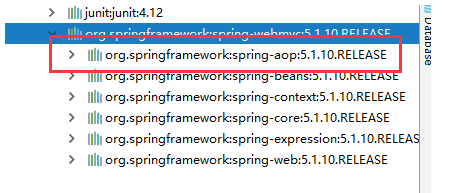
在配置文件当中，还得要引入一个 context 约束

```xml
<?xml version="1.0" encoding="UTF-8"?>
<beans xmlns="http://www.springframework.org/schema/beans"
       xmlns:xsi="http://www.w3.org/2001/XMLSchema-instance"
       xmlns:context="http://www.springframework.org/schema/context"
       xsi:schemaLocation="http://www.springframework.org/schema/beans
        http://www.springframework.org/schema/beans/spring-beans.xsd
        http://www.springframework.org/schema/context
        http://www.springframework.org/schema/context/spring-context.xsd">
</beans>

```

## Bean 的实现

我们之前都是使用 bean 的标签进行 bean 注入，但是实际开发中，我们一般都会使用注解！

配置扫描哪些包下的注解

```xml
<!--指定注解扫描包-->
<context:component-scan base-package="com.kuang.pojo"/>
```

在指定包下编写类，增加注解

```java
@Component("user")
// 相当于配置文件中 <bean id="user" class="当前注解的类"/>
public class User {
    public String name = "秦疆";
}
```

测试

```java
@Test
public void test(){
    ApplicationContext applicationContext =
        new ClassPathXmlApplicationContext("beans.xml");
    User user = (User) applicationContext.getBean("user");
    System.out.println(user.name);
}
```

## 属性注入

使用注解注入属性

可以不用提供 set 方法，直接在直接名上添加

```java
@value(“值”)

@Component("user")
// 相当于配置文件中 <bean id="user" class="当前注解的类"/>
public class User {
    @Value("秦疆")
    // 相当于配置文件中 <property name="name" value="秦疆"/>
    public String name;
}
```

如果提供了 set 方法，在 set 方法上添加

```java
@value(“值”);

@Component("user")
public class User {
    public String name;
    @Value("秦疆")
    public void setName(String name) {
        this.name = name;
    }
}

```

## 衍生注解

我们这些注解，就是替代了在配置文件当中配置步骤而已！更加的方便快捷！

@Component 三个衍生注解

为了更好的进行分层，Spring 可以使用其它三个注解，功能一样，目前使用哪一个功能都一样。

- @Controller：web 层
- @Service：service 层
- @Repository：dao 层

写上这些注解，就相当于将这个类交给 Spring 管理装配了！

## 自动装配注解

## 作用域

@scope

- singleton：默认的，Spring 会采用单例模式创建这个对象。关闭工厂 ，所有的对象都会销毁。
- prototype：多例模式。关闭工厂 ，所有的对象不会销毁。内部的垃圾回收机制会回收

```java
@Controller("user")
@Scope("prototype")
public class User {
    @Value("秦疆")
    public String name;
}
```

## 小结

**XML 与注解比较**

- XML 可以适用任何场景 ，结构清晰，维护方便

- 注解不是自己提供的类使用不了，开发简单方便

**xml 与注解整合开发 ：推荐最佳实践**

- xml 管理 Bean
- 注解完成属性注入
- 使用过程中， 可以不用扫描，扫描是为了类上的注解
  `<context:annotation-config/>`

作用：

- 进行注解驱动注册，从而使注解生效

- 用于激活那些已经在 spring 容器里注册过的 bean 上面的注解，也就是显示的向 Spring 注册

- 如果不扫描包，就需要手动配置 bean

- 如果不加注解驱动，则注入的值为 null！

## 基于 Java 类进行配置

JavaConfig 原来是 Spring 的一个子项目，它通过 Java 类的方式提供 Bean 的定义信息，在 Spring4 的版本， JavaConfig 已正式成为 Spring4 的核心功能 。

测试：

编写一个实体类，Dog

```java
@Component  //将这个类标注为Spring的一个组件，放到容器中！
public class Dog {
    public String name = "dog";
}
```

新建一个 config 配置包，编写一个 MyConfig 配置类

```java
@Configuration  //代表这是一个配置类
public class MyConfig {
    @Bean //通过方法注册一个bean，这里的返回值就Bean的类型，方法名就是bean的id！
    public Dog dog(){
        return new Dog();
    }
}
```

测试

```java
@Test
public void test2(){
    ApplicationContext applicationContext =
            new AnnotationConfigApplicationContext(MyConfig.class);
    Dog dog = (Dog) applicationContext.getBean("dog");
    System.out.println(dog.name);
}
```

成功输出结果！

**导入其他配置如何做呢？**

我们再编写一个配置类！

```java
@Configuration  //代表这是一个配置类
public class MyConfig2 {
}
```

在之前的配置类中我们来选择导入这个配置类

```java
@Configuration
@Import(MyConfig2.class)  //导入合并其他配置类，类似于配置文件中的 inculde 标签
public class MyConfig {
    @Bean
    public Dog dog(){
        return new Dog();
    }
}
```

关于这种 Java 类的配置方式，我们在之后的 SpringBoot 和 SpringCloud 中还会大量看到，我们需要知道这些注解的作用即可！

# 代理模式

AOP 的底层机制就是动态代理

代理模式：

- 静态代理
- 动态代理
  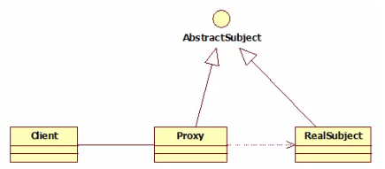

## 静态代理

静态代理角色分析：

- 抽象角色：一般使用接口或抽象类来实现
- 真实角色：被代理的角色
- 代理角色：代理真是角色；代理真是角色后，一般会做一些附属操作
- 客户：使用代理角色来进行一些操作

**代码实现：**

Rent.java ：抽象角色

```java
//抽象角色：租房
public interface Rent {
    public void rent();
}

```

Host.java ：真实角色

```java
//真实角色: 房东，房东要出租房子
public class Host implements Rent{
    public void rent() {
        System.out.println("房屋出租");
    }
}

```

Proxy.java ：代理角色

```java
//代理角色：中介
public class Proxy implements Rent {
    private Host host;
    public Proxy() { }
    public Proxy(Host host) {
        this.host = host;
    }
    //租房
    public void rent(){
        seeHouse();
        host.rent();
        fare();
    }
    //看房
    public void seeHouse(){
        System.out.println("带房客看房");
    }
    //收中介费
    public void fare(){
        System.out.println("收中介费");
    }
}

```

Client.java ：客户

```java
//客户类，一般客户都会去找代理！
public class Client {
    public static void main(String[] args) {
        //房东要租房
        Host host = new Host();
        //中介帮助房东
        Proxy proxy = new Proxy(host);
        //你去找中介！
        proxy.rent();
    }
}

```

分析： 在这个过程中，你直接接触的就是中介，就如同现实生活中的样子，你看不到房东，但是你依旧租到了房东的房子通过代理，这就是所谓的代理模式，程序源自于生活，所以学编程的人，一般能够更加抽象的看待生活中发生的事情。

## 静态代理的优点

- 可以使真实角色更加纯粹，不在关注一些公共的事情
- 公共的业务由代理完成，实现了业务分工
- 公共业务发生拓展时变得更加集中和方便

缺点：

- 一个真实类对应一个代理类，工作量变大，开发效率变低

## 静态代理 --- 联系

创建一个抽象角色，新增增删改查方法

```java
//抽象角色：增删改查业务
public interface UserService {
    void add();
    void delete();
    void update();
    void query();
}

```

实现类，即真实对象

```java
//真实对象，完成增删改查操作的人
public class UserServiceImpl implements UserService {
    public void add() {
        System.out.println("增加了一个用户");
    }
    public void delete() {
        System.out.println("删除了一个用户");
    }
    public void update() {
        System.out.println("更新了一个用户");
    }
    public void query() {
        System.out.println("查询了一个用户");
    }
}

```

设置代理类来处理新增需求

```java
//代理角色，在这里面增加日志的实现
public class UserServiceProxy implements UserService {
    private UserServiceImpl userService;
    public void setUserService(UserServiceImpl userService) {
        this.userService = userService;
    }
    public void add() {
        log("add");
        userService.add();
    }
    public void delete() {
        log("delete");
        userService.delete();
    }
    public void update() {
        log("update");
        userService.update();
    }
    public void query() {
        log("query");
        userService.query();
    }
    public void log(String msg){
        System.out.println("执行了"+msg+"方法");
    }
}

```

测试

```java
public class Client {
    public static void main(String[] args) {
        //真实业务
        UserServiceImpl userService = new UserServiceImpl();
        //代理类
        UserServiceProxy proxy = new UserServiceProxy();
        //使用代理类实现日志功能！
        proxy.setUserService(userService);
        proxy.add();
    }
}

```

AOP：并不改变原代码的情况下，完成对原有功能的增强
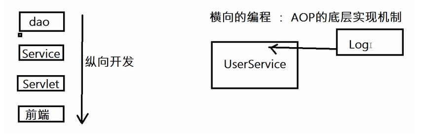

## 动态代理

- 动态代理的角色和静态代理的一样 .
- 动态代理的代理类是动态生成的 . 静态代理的代理类是我们提前写好的
- 动态代理分为两类 : 一类是基于接口动态代理 , 一类是基于类的动态代理
  - 基于接口的动态代理——JDK 动态代理
  - 基于类的动态代理—cglib
  - 现在用的比较多的是 javasist 来生成动态代理 . 百度一下 javasist
  - 我们这里使用 JDK 的原生代码来实现，其余的道理都是一样的！

JDK 的动态代理需要了解两个类

核心 : InvocationHandler 和 Proxy ， 打开 JDK 帮助文档看看

【InvocationHandler：调用处理程序】
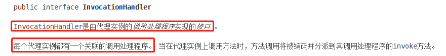

```java
Object invoke(Object proxy, 方法 method, Object[] args)；
//参数
//proxy - 调用该方法的代理实例
//method -所述方法对应于调用代理实例上的接口方法的实例。 方法对象的声明类将是该方法声明的接口，它可以是代理类继承该方法的代理接口的超级接口。
//args -包含的方法调用传递代理实例的参数值的对象的阵列，或null如果接口方法没有参数。 原始类型的参数包含在适当的原始包装器类的实例中，例如java.lang.Integer或java.lang.Boolean 。

```

【Proxy : 代理】
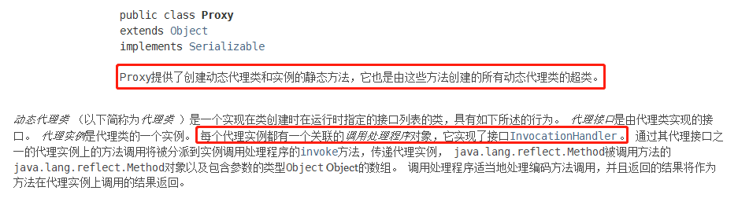
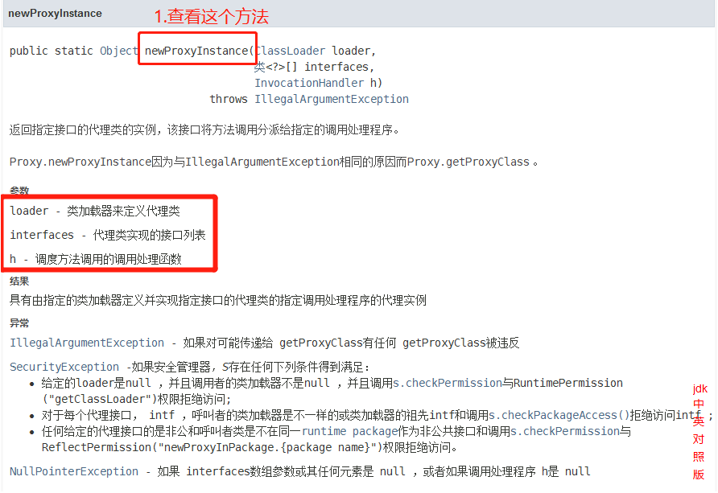

```java
//生成代理类
public Object getProxy(){
    return Proxy.newProxyInstance(this.getClass().getClassLoader(),
                                  rent.getClass().getInterfaces(),this);
}

```

**代码实现**

Rent.java 抽象角色

```java
//抽象角色：租房
public interface Rent {
    public void rent();
}
```

Host.java 真实角色

```java
//真实角色: 房东，房东要出租房子
public class Host implements Rent{
    public void rent() {
        System.out.println("房屋出租");
    }
}
```

ProxyInvocationHandler.java 代理角色

```java
public class ProxyInvocationHandler implements InvocationHandler {
    private Rent rent;
    public void setRent(Rent rent) {
        this.rent = rent;
    }
    //生成代理类，重点是第二个参数，获取要代理的抽象角色！之前都是一个角色，现在可以代理一类角色
    public Object getProxy(){
        return Proxy.newProxyInstance(this.getClass().getClassLoader(),
                rent.getClass().getInterfaces(),this);
    }
    // proxy : 代理类 method : 代理类的调用处理程序的方法对象.
    // 处理代理实例上的方法调用并返回结果
    @Override
    public Object invoke(Object proxy, Method method, Object[] args) throws Throwable {
        seeHouse();
        //核心：本质利用反射实现！
        Object result = method.invoke(rent, args);
        fare();
        return result;
    }
    //看房
    public void seeHouse(){
        System.out.println("带房客看房");
    }
    //收中介费
    public void fare(){
        System.out.println("收中介费");
    }
}

```

Client.java

```java
//租客
public class Client {
    public static void main(String[] args) {
        //真实角色
        Host host = new Host();
        //代理实例的调用处理程序
        ProxyInvocationHandler pih = new ProxyInvocationHandler();
        pih.setRent(host); //将真实角色放置进去！
        Rent proxy = (Rent)pih.getProxy(); //动态生成对应的代理类！
        proxy.rent();
    }
}

```

核心：**一个动态代理 , 一般代理某一类业务 , 一个动态代理可以代理多个类，代理的是接口！**

## 通用代理类

```java
public class ProxyInvocationHandler implements InvocationHandler {
    private Object target;
    public void setTarget(Object target) {
        this.target = target;
    }
    //生成代理类
    public Object getProxy(){
        return Proxy.newProxyInstance(this.getClass().getClassLoader(),
                target.getClass().getInterfaces(),this);
    }
    // proxy : 代理类
    // method : 代理类的调用处理程序的方法对象.
    public Object invoke(Object proxy, Method method, Object[] args) throws Throwable {
        log(method.getName());
        Object result = method.invoke(target, args);
        return result;
    }
    public void log(String methodName){
        System.out.println("执行了"+methodName+"方法");
    }
}

```

测试

```java
public class Test {
    public static void main(String[] args) {
        //真实对象
        UserServiceImpl userService = new UserServiceImpl();
        //代理对象的调用处理程序
        ProxyInvocationHandler pih = new ProxyInvocationHandler();
        pih.setTarget(userService); //设置要代理的对象
        UserService proxy = (UserService)pih.getProxy(); //动态生成代理类！
        proxy.delete();
    }
}

```

## 优点

- 可以使得我们的真实角色更加纯粹 . 不再去关注一些公共的事情
- 公共的业务由代理来完成 . 实现了业务的分工
- 公共业务发生扩展时变得更加集中和方便
- 一个动态代理，一般代理某一类业务
- 一个动态代理可以代理多个类，代理的是接口

# AOP

## 什么是 AOP

AOP（Aspect Oriented Programming）意为：面向切面编程，通过预编译方式和运行期动态代理实现程序功能的统一维护的一种技术。AOP 是 OOP 的延续，是软件开发中的一个热点，也是 Spring 框架中的一个重要内容，是函数式编程的一种衍生范型。利用 AOP 可以对业务逻辑的各个部分进行隔离，从而使得业务逻辑各部分之间的耦合度降低，提高程序的可重用性，同时提高了开发的效率。
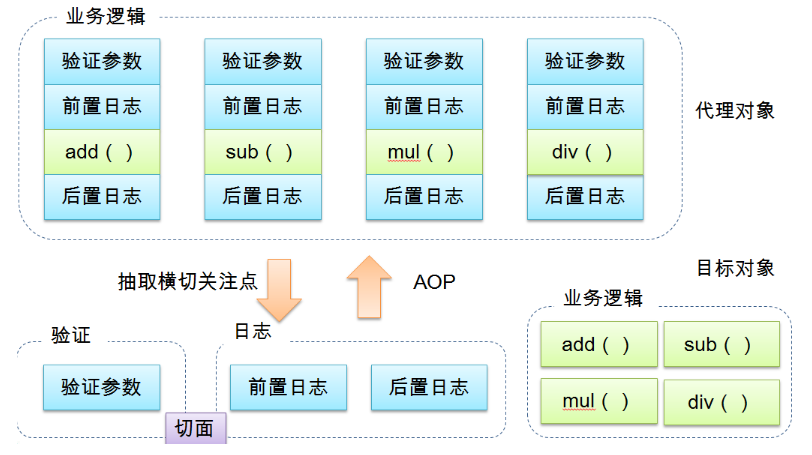

## AOP 在 Spring 中的作用

**提供声明式事务：允许童虎自定义切面**

- 横切关注点：跨越应用程序多个模块的方法或功能。即是，与我们业务逻辑无关的，但是我们需要关注的部分，就是横切关注点。如日志 , 安全 , 缓存 , 事务等等 ….

- 切面（ASPECT）：横切关注点 被模块化 的特殊对象。即，它是一个类。

- 通知（Advice）：切面必须要完成的工作。即，它是类中的一个方法。

- 目标（Target）：被通知对象。

- 代理（Proxy）：向目标对象应用通知之后创建的对象。

- 切入点（PointCut）：切面通知 执行的 “地点”的定义。

- 连接点（JointPoint）：与切入点匹配的执行点。

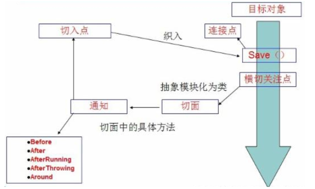

SpringAOP 中，通过 Advice 定义横切逻辑，Spring 中支持 5 种类型的 Advice:
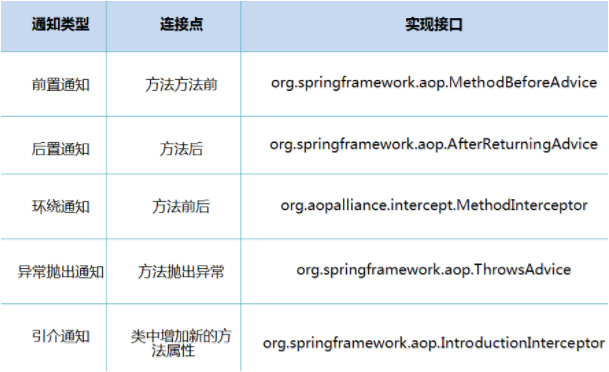

即 Aop 在 不改变原有代码的情况下 , 去增加新的功能

## 使用 Spring 实现 AOP

导入依赖：

```xml
<!-- https://mvnrepository.com/artifact/org.aspectj/aspectjweaver -->
<dependency>
    <groupId>org.aspectj</groupId>
    <artifactId>aspectjweaver</artifactId>
    <version>1.9.4</version>
</dependency>

```

### 1.通过 Spring API 实现

接口：

```java
public interface UserService {
    public void add();
    public void delete();
    public void update();
    public void search();
}

```

实现类：

```java
public class UserServiceImpl implements UserService{
    @Override
    public void add() {
        System.out.println("增加用户");
    }
    @Override
    public void delete() {
        System.out.println("删除用户");
    }
    @Override
    public void update() {
        System.out.println("更新用户");
    }
    @Override
    public void search() {
        System.out.println("查询用户");
    }
}

```

前置增强、后置增强：

```java
public class Log implements MethodBeforeAdvice {
    //method : 要执行的目标对象的方法
    //objects : 被调用的方法的参数
    //Object : 目标对象
    @Override
    public void before(Method method, Object[] objects, Object o) throws Throwable {
        System.out.println( o.getClass().getName() + "的" + method.getName() + "方法被执行了");
    }
}

```

```java
public class AfterLog implements AfterReturningAdvice {
    //returnValue 返回值
    //method被调用的方法
    //args 被调用的方法的对象的参数
    //target 被调用的目标对象
    @Override
    public void afterReturning(Object returnValue, Method method, Object[] args, Object target) throws Throwable {
        System.out.println("执行了" + target.getClass().getName()
        +"的"+method.getName()+"方法,"
        +"返回值："+returnValue);
    }
}

```

最后去 spring 的文件中注册 , 并实现 aop 切入实现，注意导入约束

```xml
<?xml version="1.0" encoding="UTF-8"?>
<beans xmlns="http://www.springframework.org/schema/beans"
       xmlns:xsi="http://www.w3.org/2001/XMLSchema-instance"
       xmlns:aop="http://www.springframework.org/schema/aop"
       xsi:schemaLocation="http://www.springframework.org/schema/beans
        http://www.springframework.org/schema/beans/spring-beans.xsd
        http://www.springframework.org/schema/aop
        http://www.springframework.org/schema/aop/spring-aop.xsd">
    <!--注册bean-->
    <bean id="userService" class="com.kuang.service.UserServiceImpl"/>
    <bean id="log" class="com.kuang.log.Log"/>
    <bean id="afterLog" class="com.kuang.log.AfterLog"/>
    <!--aop的配置-->
    <aop:config>
        <!--切入点  expression:表达式匹配要执行的方法-->
        <aop:pointcut id="pointcut" expression="execution(* com.kuang.service.UserServiceImpl.*(..))"/>
        <!--执行环绕; advice-ref执行方法 . pointcut-ref切入点-->
        <aop:advisor advice-ref="log" pointcut-ref="pointcut"/>
        <aop:advisor advice-ref="afterLog" pointcut-ref="pointcut"/>
    </aop:config>
</beans>

```

测试：

```java
public class MyTest {
    @Test
    public void test(){
        ApplicationContext context = new ClassPathXmlApplicationContext("beans.xml");
        UserService userService = (UserService) context.getBean("userService");
        userService.search();
    }
}

```

### 2.自定义类实现 AOP

目标业务类不变依旧是 userServiceImpl

第一步 : 写我们自己的一个切入类

```java
public class DiyPointcut {
    public void before(){
        System.out.println("---------方法执行前---------");
    }
    public void after(){
        System.out.println("---------方法执行后---------");
    }
}

```

去 spring 中配置

```xml
<!--第二种方式自定义实现-->
<!--注册bean-->
<bean id="diy" class="com.kuang.config.DiyPointcut"/>
<!--aop的配置-->
<aop:config>
    <!--第二种方式：使用AOP的标签实现-->
    <aop:aspect ref="diy">
        <aop:pointcut id="diyPonitcut" expression="execution(* com.kuang.service.UserServiceImpl.*(..))"/>
        <aop:before pointcut-ref="diyPonitcut" method="before"/>
        <aop:after pointcut-ref="diyPonitcut" method="after"/>
    </aop:aspect>
</aop:config>

```

测试

```java
public class MyTest {
    @Test
    public void test(){
        ApplicationContext context = new ClassPathXmlApplicationContext("beans.xml");
        UserService userService = (UserService) context.getBean("userService");
        userService.add();
    }
}

```

### 3.使用注解实现

第一步：编写一个注解实现的增强类

```java
package com.kuang.config;
import org.aspectj.lang.ProceedingJoinPoint;
import org.aspectj.lang.annotation.After;
import org.aspectj.lang.annotation.Around;
import org.aspectj.lang.annotation.Aspect;
import org.aspectj.lang.annotation.Before;
@Aspect
public class AnnotationPointcut {
    @Before("execution(* com.kuang.service.UserServiceImpl.*(..))")
    public void before(){
        System.out.println("---------方法执行前---------");
    }
    @After("execution(* com.kuang.service.UserServiceImpl.*(..))")
    public void after(){
        System.out.println("---------方法执行后---------");
    }
    @Around("execution(* com.kuang.service.UserServiceImpl.*(..))")
    public void around(ProceedingJoinPoint jp) throws Throwable {
        System.out.println("环绕前");
        System.out.println("签名:"+jp.getSignature());
        //执行目标方法proceed
        Object proceed = jp.proceed();
        System.out.println("环绕后");
        System.out.println(proceed);
    }
}

```

第二步：在 Spring 配置文件中，注册 bean，并增加支持注解的配置

```xml
<!--第三种方式:注解实现-->
<bean id="annotationPointcut" class="com.kuang.config.AnnotationPointcut"/>
<aop:aspectj-autoproxy/>

```

aop:aspectj-autoproxy：说明

```xml
通过aop命名空间的<aop:aspectj-autoproxy />声明自动为spring容器中那些配置@aspectJ切面的bean创建代理，织入切面。当然，spring 在内部依旧采用AnnotationAwareAspectJAutoProxyCreator进行自动代理的创建工作，但具体实现的细节已经被<aop:aspectj-autoproxy />隐藏起来了
<aop:aspectj-autoproxy />有一个proxy-target-class属性，默认为false，表示使用jdk动态代理织入增强，当配为<aop:aspectj-autoproxy  poxy-target-class="true"/>时，表示使用CGLib动态代理技术织入增强。不过即使proxy-target-class设置为false，如果目标类没有声明接口，则spring将自动使用CGLib动态代理。

```

# Spring 整合 MyBatis

步骤：
导入相关 jar

junit

```xml
<dependency>
    <groupId>junit</groupId>
    <artifactId>junit</artifactId>
    <version>4.12</version>
</dependency>
```

mybatis

```xml
<dependency>
    <groupId>org.mybatis</groupId>
    <artifactId>mybatis</artifactId>
    <version>3.5.2</version>
</dependency>
```

mysql-connector-java

```xml
<dependency>
    <groupId>mysql</groupId>
    <artifactId>mysql-connector-java</artifactId>
    <version>5.1.47</version>
</dependency>
```

spring 相关

```xml
<dependency>
    <groupId>org.springframework</groupId>
    <artifactId>spring-webmvc</artifactId>
    <version>5.1.10.RELEASE</version>
</dependency>
<dependency>
    <groupId>org.springframework</groupId>
    <artifactId>spring-jdbc</artifactId>
    <version>5.1.10.RELEASE</version>
</dependency>
```

aspectJ AOP 织入器

```xml
<!-- https://mvnrepository.com/artifact/org.aspectj/aspectjweaver -->
<dependency>
    <groupId>org.aspectj</groupId>
    <artifactId>aspectjweaver</artifactId>
    <version>1.9.4</version>
</dependency>
```

mybatis-spring 整合包 【重点】

```xml
<dependency>
    <groupId>org.mybatis</groupId>
    <artifactId>mybatis-spring</artifactId>
    <version>2.0.2</version>
</dependency>
```

配置 Maven 静态资源过滤问题！

```xml
<build>
    <resources>
        <resource>
            <directory>src/main/java</directory>
            <includes>
                <include>**/*.properties</include>
                <include>**/*.xml</include>
            </includes>
            <filtering>true</filtering>
        </resource>
    </resources>
</build>
```

编写配置文件

代码实现

## MyBatis 的简单实现

编写实体类：

```java
package com.kuang.pojo;
public class User {
    private int id;  //id
    private String name;   //姓名
    private String pwd;   //密码
}

```

编写配置文件：

```xml
<?xml version="1.0" encoding="UTF-8" ?>
<!DOCTYPE configuration
        PUBLIC "-//mybatis.org//DTD Config 3.0//EN"
        "http://mybatis.org/dtd/mybatis-3-config.dtd">
<configuration>
    <typeAliases>
        <package name="com.kuang.pojo"/>
    </typeAliases>
    <environments default="development">
        <environment id="development">
            <transactionManager type="JDBC"/>
            <dataSource type="POOLED">
                <property name="driver" value="com.mysql.jdbc.Driver"/>
                <property name="url" value="jdbc:mysql://localhost:3306/mybatis?useSSL=true&amp;useUnicode=true&amp;characterEncoding=utf8"/>
                <property name="username" value="root"/>
                <property name="password" value="123456"/>
            </dataSource>
        </environment>
    </environments>
    <mappers>
        <package name="com.kuang.dao"/>
    </mappers>
</configuration>

```

编写 Mapper 接口

```java
public interface UserMapper {
    public List<User> selectUser();
}

```

编写 Mapper 对应的映射文件：

```xml
<?xml version="1.0" encoding="UTF-8" ?>
<!DOCTYPE mapper
        PUBLIC "-//mybatis.org//DTD Mapper 3.0//EN"
        "http://mybatis.org/dtd/mybatis-3-mapper.dtd">
<mapper namespace="com.kuang.dao.UserMapper">
    <select id="selectUser" resultType="User">
      select * from user
    </select>
</mapper>

```

测试：

```java
@Test
public void selectUser() throws IOException {
    String resource = "mybatis-config.xml";
    InputStream inputStream = Resources.getResourceAsStream(resource);
    SqlSessionFactory sqlSessionFactory = new SqlSessionFactoryBuilder().build(inputStream);
    SqlSession sqlSession = sqlSessionFactory.openSession();
    UserMapper mapper = sqlSession.getMapper(UserMapper.class);
    List<User> userList = mapper.selectUser();
    for (User user: userList){
        System.out.println(user);
    }
    sqlSession.close();
}

```

## MyBatis-Spring

Mybatis-Spring 中的一些重要类
[https://github.com/mybatis/spring](https://github.com/mybatis/spring)
[https://github.com/mybatis/ibatis-spring](https://github.com/mybatis/ibatis-spring)


**什么是 MyBatis-Spring？**

MyBatis-Spring 会帮助你将 MyBatis 代码无缝地整合到 Spring 中。

**知识基础**

在开始使用 MyBatis-Spring 之前，你需要先熟悉 Spring 和 MyBatis 这两个框架和有关它们的术语。这很重要

MyBatis-Spring 需要以下版本：
| MyBatis-Spring | MyBatis | Spring 框架 | Spring Batch | Java |
| - | - | - | - | - |
| 2.0 | 3.5+ | 5.0+ | 4.0+ | Java 8+ |
| 1.3 | 3.4+ | 3.2.2+ | 2.1+ | Java 6+ |

如果使用 Maven 作为构建工具，仅需要在 pom.xml 中加入以下代码即可：

```xml
<dependency>
    <groupId>org.mybatis</groupId>
    <artifactId>mybatis-spring</artifactId>
    <version>2.0.2</version>
</dependency>
```

要和 Spring 一起使用 MyBatis，需要在 Spring 应用上下文中定义至少两样东西：一个 `SqlSessionFactory` 和至少一个数据映射器类。

在 MyBatis-Spring 中，可使用 `SqlSessionFactoryBean`来创建 `SqlSessionFactory`。 要配置这个工厂 bean，只需要把下面代码放在 Spring 的 XML 配置文件中：

```xml
<bean id="sqlSessionFactory" class="org.mybatis.spring.SqlSessionFactoryBean">
  <property name="dataSource" ref="dataSource" />
</bean>

```

注意：`SqlSessionFactory` 需要一个 `DataSource`（数据源）。 这可以是任意的 DataSource，只需要和配置其它 Spring 数据库连接一样配置它就可以了。

在基础的 MyBatis 用法中，是通过 `SqlSessionFactoryBuilder` 来创建 `SqlSessionFactory` 的。 而在 MyBatis-Spring 中，则使用 `SqlSessionFactoryBean` 来创建。

在 MyBatis 中，你可以使用 `SqlSessionFactory` 来创建 `SqlSession`。一旦你获得一个 session 之后，你可以使用它来执行映射了的语句，提交或回滚连接，最后，当不再需要它的时候，你可以关闭 session。

`SqlSessionFactory` 有一个唯一的必要属性：用于 JDBC 的 `DataSource`。这可以是任意的 `DataSource` 对象，它的配置方法和其它 Spring 数据库连接是一样的。

一个常用的属性是 `configLocation`，它用来指定 MyBatis 的 XML 配置文件路径。它在需要修改 MyBatis 的基础配置非常有用。通常，基础配置指的是 `<settings>` 或 `<typeAliases> `元素。

需要注意的是，这个配置文件**并不需要**是一个完整的 MyBatis 配置。确切地说，任何环境配置（`<environments>`），数据源（`<DataSource>`）和 MyBatis 的事务管理器（`<transactionManager>`）都会被**忽略**。SqlSessionFactoryBean 会创建它自有的 MyBatis 环境配置（`Environment`），并按要求设置自定义环境的值。

`SqlSessionTemplate` 是 MyBatis-Spring 的核心。作为 `SqlSession` 的一个实现，这意味着可以使用它无缝代替你代码中已经在使用的 `SqlSession`。

模板可以参与到 Spring 的事务管理中，并且由于其是线程安全的，可以供多个映射器类使用，你应该**总是**用 `SqlSessionTemplate` 来替换 MyBatis 默认的 `DefaultSqlSession` 实现。在同一应用程序中的不同类之间混杂使用可能会引起数据一致性的问题。

可以使用 `SqlSessionFactory` 作为构造方法的参数来创建 `SqlSessionTemplate` 对象。

```xml
<bean id="sqlSession" class="org.mybatis.spring.SqlSessionTemplate">
  <constructor-arg index="0" ref="sqlSessionFactory" />
</bean>

```

现在，这个 bean 就可以直接注入到你的 DAO bean 中了。你需要在你的 bean 中添加一个 SqlSession 属性，就像下面这样：

```java
public class UserDaoImpl implements UserDao {
  private SqlSession sqlSession;
  public void setSqlSession(SqlSession sqlSession) {
    this.sqlSession = sqlSession;
  }
  public User getUser(String userId) {
    return sqlSession.getMapper...;
  }
}

```

按下面这样，注入 `SqlSessionTemplate`：

```xml
<bean id="userDao" class="org.mybatis.spring.sample.dao.UserDaoImpl">
  <property name="sqlSession" ref="sqlSession" />
</bean>

```

## 整合实现-

引入 Spring 配置文件 beans.xml

```xml
<?xml version="1.0" encoding="UTF-8"?>
<beans xmlns="http://www.springframework.org/schema/beans"
       xmlns:xsi="http://www.w3.org/2001/XMLSchema-instance"
       xsi:schemaLocation="http://www.springframework.org/schema/beans
        http://www.springframework.org/schema/beans/spring-beans.xsd">

```

配置数据源替换 mybaits 的数据源

```xml
<!--配置数据源：数据源有非常多，可以使用第三方的，也可使使用Spring的-->
<bean id="dataSource" class="org.springframework.jdbc.datasource.DriverManagerDataSource">
    <property name="driverClassName" value="com.mysql.jdbc.Driver"/>
    <property name="url" value="jdbc:mysql://localhost:3306/mybatis?useSSL=true&amp;useUnicode=true&amp;characterEncoding=utf8"/>
    <property name="username" value="root"/>
    <property name="password" value="123456"/>
</bean>

```

配置 SqlSessionFactory，关联 MyBatis

```xml
<!--配置SqlSessionFactory-->
<bean id="sqlSessionFactory" class="org.mybatis.spring.SqlSessionFactoryBean">
    <property name="dataSource" ref="dataSource"/>
    <!--关联Mybatis-->
    <property name="configLocation" value="classpath:mybatis-config.xml"/>
    <property name="mapperLocations" value="classpath:com/kuang/dao/*.xml"/>
</bean>

```

注册 sqlSessionTemplate，关联 sqlSessionFactory；

```xml
<!--注册sqlSessionTemplate , 关联sqlSessionFactory-->
<bean id="sqlSession" class="org.mybatis.spring.SqlSessionTemplate">
    <!--利用构造器注入-->
    <constructor-arg index="0" ref="sqlSessionFactory"/>
</bean>

```

增加 Dao 接口的实现类；私有化 sqlSessionTemplate

```java
public class UserDaoImpl implements UserMapper {
    //sqlSession不用我们自己创建了，Spring来管理
    private SqlSessionTemplate sqlSession;
    public void setSqlSession(SqlSessionTemplate sqlSession) {
        this.sqlSession = sqlSession;
    }
    public List<User> selectUser() {
        UserMapper mapper = sqlSession.getMapper(UserMapper.class);
        return mapper.selectUser();
    }
}

```

注册 bean 实现

```xml
<bean id="userDao" class="com.kuang.dao.UserDaoImpl">
    <property name="sqlSession" ref="sqlSession"/>
</bean>

```

测试

```java
    @Test
    public void test2(){
        ApplicationContext context = new ClassPathXmlApplicationContext("beans.xml");
        UserMapper mapper = (UserMapper) context.getBean("userDao");
        List<User> user = mapper.selectUser();
        System.out.println(user);
    }

```

结果成功输出！现在我们的 Mybatis 配置文件的状态！发现都可以被 Spring 整合！

```xml
<?xml version="1.0" encoding="UTF-8" ?>
<!DOCTYPE configuration
        PUBLIC "-//mybatis.org//DTD Config 3.0//EN"
        "http://mybatis.org/dtd/mybatis-3-config.dtd">
<configuration>
    <typeAliases>
        <package name="com.kuang.pojo"/>
    </typeAliases>
</configuration>

```

## 整合实现二

mybatis-spring1.2.3 版以上的才有这个 .

官方文档截图 :
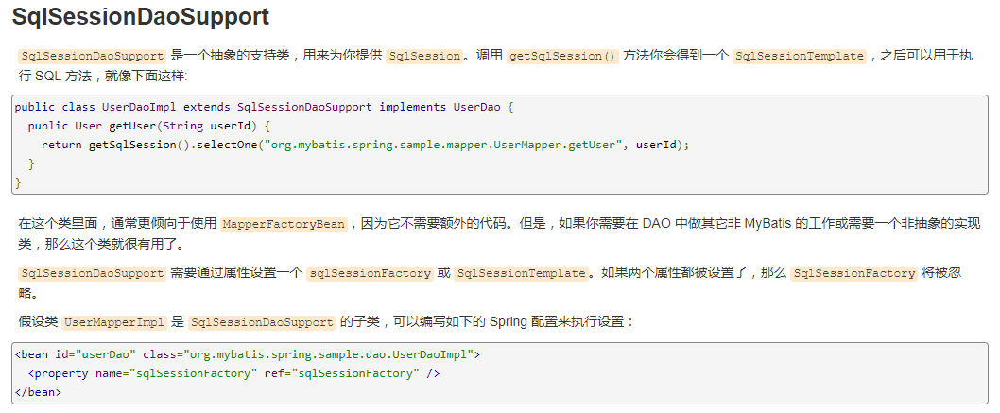
dao 继承 Support 类 , 直接利用 getSqlSession() 获得 , 然后直接注入 SqlSessionFactory . 比起方式 1 , 不需要管理 SqlSessionTemplate , 而且对事务的支持更加友好 . 可跟踪源码查看

测试：

将我们上面写的 UserDaoImpl 修改一下

```java
public class UserDaoImpl extends SqlSessionDaoSupport implements UserMapper {
    public List<User> selectUser() {
        UserMapper mapper = getSqlSession().getMapper(UserMapper.class);
        return mapper.selectUser();
    }
}
```

修改 bean 的配置

```xml
<bean id="userDao" class="com.kuang.dao.UserDaoImpl">
    <property name="sqlSessionFactory" ref="sqlSessionFactory" />
</bean>
```

测试

```java
@Test
public void test2(){
    ApplicationContext context = new ClassPathXmlApplicationContext("beans.xml");
    UserMapper mapper = (UserMapper) context.getBean("userDao");
    List<User> user = mapper.selectUser();
    System.out.println(user);
}
```

总结 : 整合到 spring 中以后可以完全不要 mybatis 的配置文件，除了这些方式可以实现整合之外，我们还可以使用注解来实现，这个等我们后面学习 SpringBoot 的时候还会测试整合！

# 声明式事务

## 回顾事务

- 事务在项目开发过程非常重要，涉及到数据的一致性的问题，不容马虎！
- 事务管理是企业级应用程序开发中必备技术，用来确保数据的完整性和一致性。

**事务就是把一系列的动作当成一个独立的工作单元，这些动作要么全部完成，要么全部不起作用。**

### 事务的四个属性 ACID

原子性（atomicity）

- 事务是原子性操作，由一系列动作组成，事务的原子性确保动作要么全部完成，要么完全不起作用

一致性（consistency）

- 一旦所有事务动作完成，事务就要被提交。数据和资源处于一种满足业务规则的一致性状态中

隔离性（isolation）

- 可能多个事务会同时处理相同的数据，因此每个事务都应该与其他事务隔离开来，防止数据损坏

持久性（durability）

- 事务一旦完成，无论系统发生什么错误，结果都不会受到影响。通常情况下，事务的结果被写到持久化存储器中

## 测试

将上面的代码拷贝到一个新项目中

在之前的案例中，我们给 userDao 接口新增两个方法，删除和增加用户；

```java
//添加一个用户
int addUser(User user);
//根据id删除用户
int deleteUser(int id);
```

mapper 文件，我们故意把 deletes 写错，测试！

```xml
 <insert id="addUser" parameterType="com.kuang.pojo.User">
 insert into user (id,name,pwd) values (#{id},#{name},#{pwd})
 </insert>
 <delete id="deleteUser" parameterType="int">
 deletes from user where id = #{id}
</delete>
```

编写接口的实现类，在实现类中，我们去操作一波

```java
public class UserDaoImpl extends SqlSessionDaoSupport implements UserMapper {
    //增加一些操作
    public List<User> selectUser() {
        User user = new User(4,"小明","123456");
        UserMapper mapper = getSqlSession().getMapper(UserMapper.class);
        mapper.addUser(user);
        mapper.deleteUser(4);
        return mapper.selectUser();
    }
    //新增
    public int addUser(User user) {
        UserMapper mapper = getSqlSession().getMapper(UserMapper.class);
        return mapper.addUser(user);
    }
    //删除
    public int deleteUser(int id) {
        UserMapper mapper = getSqlSession().getMapper(UserMapper.class);
        return mapper.deleteUser(id);
    }
}
```

测试

```java
@Test
public void test2(){
    ApplicationContext context = new ClassPathXmlApplicationContext("beans.xml");
    UserMapper mapper = (UserMapper) context.getBean("userDao");
    List<User> user = mapper.selectUser();
    System.out.println(user);
}
```

报错：sql 异常，delete 写错了

结果 ：插入成功！

没有进行事务的管理；我们想让他们都成功才成功，有一个失败，就都失败，我们就应该需要**事务**！

以前我们都需要自己手动管理事务，十分麻烦！

但是 Spring 给我们提供了事务管理，我们只需要配置即可；

## Spring 中的事务管理

Spring 在不同的事务管理 API 之上定义了一个抽象层，使得开发人员不必了解底层的事务管理 API 就可以使用 Spring 的事务管理机制。Spring 支持编程式事务管理和声明式的事务管理。

### 编程式事务管理

- 将事务管理代码嵌到业务方法中来控制事务的提交和回滚
- 缺点：必须在每个事务操作业务逻辑中包含额外的事务管理代码

### 声明式事务管理

- 一般情况下比编程式事务好用。
- 将事务管理代码从业务方法中分离出来，以声明的方式来实现事务管理。
- 将事务管理作为横切关注点，通过 aop 方法模块化。Spring 中通过 Spring AOP 框架支持声明式事务管理。

### 使用 Spring 管理事务，注意头文件的约束导入 : tx

```xml
xmlns:tx="http://www.springframework.org/schema/tx"
http://www.springframework.org/schema/tx
http://www.springframework.org/schema/tx/spring-tx.xsd">
```

### 事务管理器

- 无论使用 Spring 的哪种事务管理策略（编程式或者声明式）事务管理器都是必须的。

- 就是 Spring 的核心事务管理抽象，管理封装了一组独立于技术的方法。

### JDBC 事务

```xml
<bean id="transactionManager" class="org.springframework.jdbc.datasource.DataSourceTransactionManager">
        <property name="dataSource" ref="dataSource" />
 </bean>
```

### 配置好事务管理器后我们需要去配置事务的通知

```xml
<!--配置事务通知-->
<tx:advice id="txAdvice" transaction-manager="transactionManager">
    <tx:attributes>
        <!--配置哪些方法使用什么样的事务,配置事务的传播特性-->
        <tx:method name="add" propagation="REQUIRED"/>
        <tx:method name="delete" propagation="REQUIRED"/>
        <tx:method name="update" propagation="REQUIRED"/>
        <tx:method name="search*" propagation="REQUIRED"/>
        <tx:method name="get" read-only="true"/>
        <tx:method name="*" propagation="REQUIRED"/>
    </tx:attributes>
</tx:advice>
```

### spring 事务传播特性：

事务传播行为就是多个事务方法相互调用时，事务如何在这些方法间传播。spring 支持 7 种事务传播行为：

- propagation_requierd：如果当前没有事务，就新建一个事务，如果已存在一个事务中，加入到这个事务中，这是最常见的选择。
- propagation_supports：支持当前事务，如果没有当前事务，就以非事务方法执行。
- propagation_mandatory：使用当前事务，如果没有当前事务，就抛出异常。
- propagation_required_new：新建事务，如果当前存在事务，把当前事务挂起。
- propagation_not_supported：以非事务方式执行操作，如果当前存在事务，就把当前事务挂起。
- propagation_never：以非事务方式执行操作，如果当前事务存在则抛出异常。
- propagation_nested：如果当前存在事务，则在嵌套事务内执行。如果当前没有事务，则执行与 propagation_required 类似的操作

Spring 默认的事务传播行为是 PROPAGATION_REQUIRED，它适合于绝大多数的情况。

假设 ServiveX#methodX() 都工作在事务环境下（即都被 Spring 事务增强了），假设程序中存在如下的调用链：Service1#method1()->Service2#method2()->Service3#method3()，那么这 3 个服务类的 3 个方法通过 Spring 的事务传播机制都工作在同一个事务中。

就好比，我们刚才的几个方法存在调用，所以会被放在一组事务当中！

### 配置 AOP

导入 aop 的头文件！

```xml
<!--配置aop织入事务-->
<aop:config>
    <aop:pointcut id="txPointcut" expression="execution(* com.kuang.dao.*.*(..))"/>
    <aop:advisor advice-ref="txAdvice" pointcut-ref="txPointcut"/>
</aop:config>
```

### 进行测试

删掉刚才插入的数据，再次测试！

```java
@Test
public void test2(){
    ApplicationContext context = new ClassPathXmlApplicationContext("beans.xml");
    UserMapper mapper = (UserMapper) context.getBean("userDao");
    List<User> user = mapper.selectUser();
    System.out.println(user);
}
```

## 思考

为什么需要配置事务？

- 如果不配置，就需要我们手动提交控制事务；

- 事务在项目开发过程非常重要，涉及到数据的一致性的问题，不容马虎